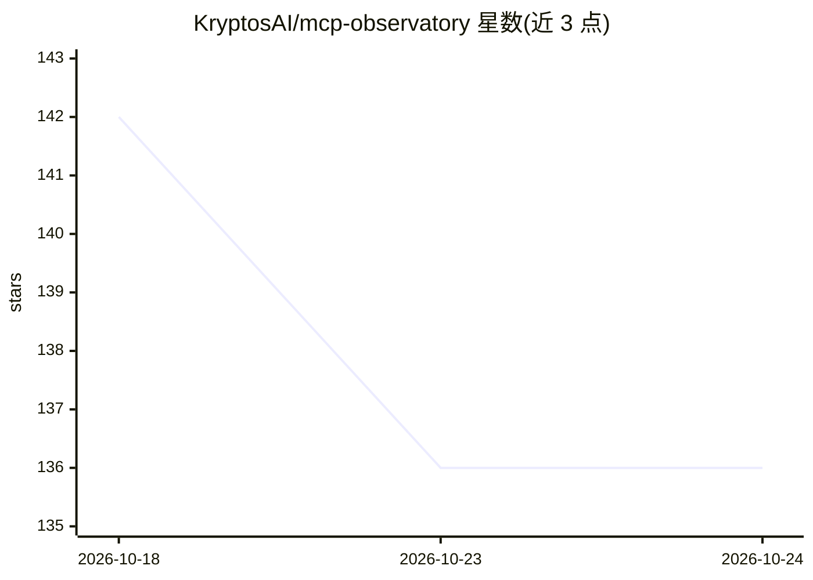

# KryptosAI/mcp-observatory

⭐ 136 · TypeScript · MIT · 推送 2026-10-21 · [GitHub](https://github.com/KryptosAI/mcp-observatory) · [官网](https://clearframecode.com/observatory/?utm_source=mcp-observatory&utm_medium=github&utm_campaign=opensource) · 组织维护 · 中文 README

**MCP 服务器安全测试与审计工具，面向发布 MCP 服务器的团队**

面向开发和维护自定义 MCP 服务器的团队的安全测试工具：扫描并连接服务器验证工具/提示/资源是否正常，实际调用安全工具报告可用性，检测 schema 漂移，分析工具 schema 中的危险模式（shell 注入面、宽泛文件系统访问、缺失认证、凭证泄漏），并提供健康评分、MCP 回执、风险图、GitHub Action CI 集成与 SARIF 输出。支持 record/replay/verify 离线回归测试，可自身以 MCP 服务器模式运行供 agent 调用。本地功能免费 MIT 许可，可选接入 ClearFrame CLI/Mac（Apple Silicon）。README 声明这些检查识别审查候选但不证明服务器安全。

## 筛选速览

| 维度 | 判定 | 备注 |
|---|---|---|
| AI 角色 | `ai-ecosystem` | LLM/agent 周边工具 |
| 许可风险 | `permissive` | MIT |
| 部署形态 | `self-host` | docker 或自建部署 |
| 模型依赖 | — | README 未给出锁定关系 |
| 硬件要求 | — | 无带数字的原话,不猜 |
| 安装摩擦 | `low` | 无编译、无系统依赖或容器化 |
| 成熟度 | — | 结构信号不足 |

## 能力要点

- 扫描并实际调用安全工具验证 MCP 服务器可用性
- 安全扫描检测 shell 注入面、宽泛文件访问、缺失认证等危险模式
- schema 漂移检测与 record/replay/verify 离线回归工作流
- setup-ci 生成 GitHub Action，输出 SARIF 到 Code Scanning

## 适用场景

- 团队在 CI 中对自研 MCP 服务器做安全与兼容性检查
- 对比两次运行检测 MCP 服务器的 schema 漂移与回归
- 让 agent 通过 MCP 服务器模式直接检查其他 MCP 服务器
- 为 MCP 服务器生成健康评分徽章与合规回执

## 场景标签

`网络安全` · 领域:学习与行业

## 证据(README 行号)

> L30: **Free, open-source MCP security testing from ClearFrame.** MCP Observatory is the CI-native security tool for team
> L104: MCP servers are becoming production dependencies. If agents rely on them, teams need a way to catch broken tools, 
> L207: |`serve`|Start as an MCP server for AI agents|

## 星数曲线

2026-10-18 142 → 2026-10-24 136（-6）

---
*卡片 v1 · prompt 1.4 · 生成 2026-10-23 · 置信度 high · 依据 README sha `e7b6a68e452a` · [字段定义](../../DATASET.md)*
