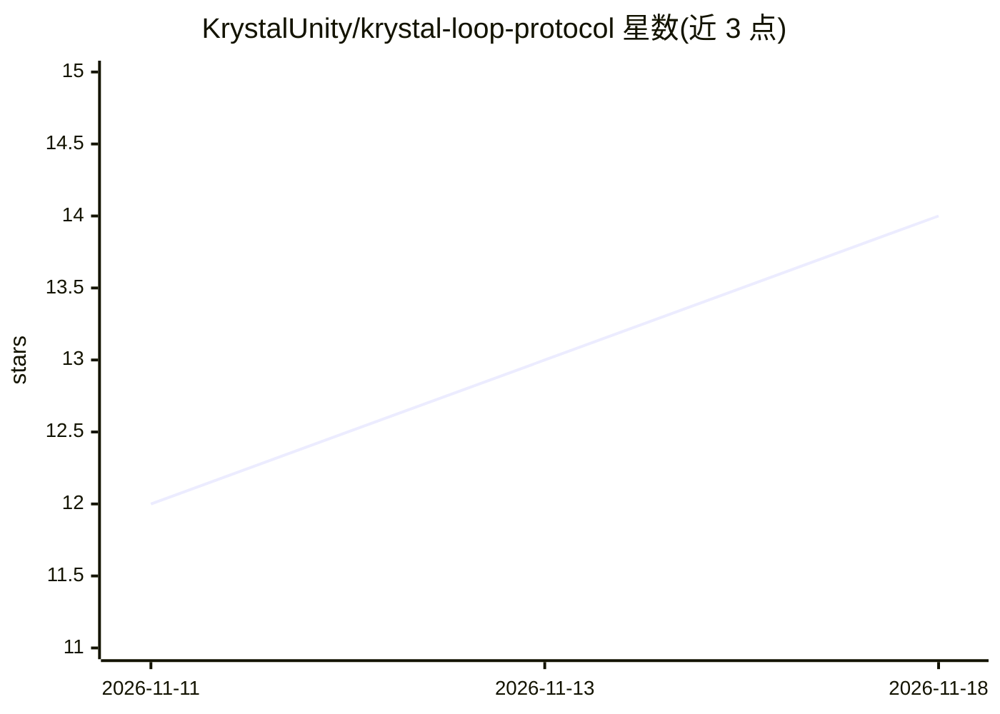

# KrystalUnity/krystal-loop-protocol

⭐ 14 · Python · NOASSERTION · 推送 2026-11-11 · [GitHub](https://github.com/KrystalUnity/krystal-loop-protocol) · [官网](https://krystalunity.com/krystal-loop) · 组织维护

**廉价模型编码+前沿模型复核的 AI 编码循环运行器**

提供一条命令的编码任务循环运行器：低成本低成本模型在仓库沙箱副本中构建改动，运行器执行用户声明的检查，另一模型家族的评审者读取任务、diff 与检查输出的紧凑包进行复核；每个阻断性发现附带探针测试，失败才触发有界修复，最终产出补丁、明文回执与决策。回执可重算验证，成本上限、步数上限与修复上限可配置。要求 Linux/WSL、Python 3.11+、Git 与 bubblewrap。

## 筛选速览

| 维度 | 判定 | 备注 |
|---|---|---|
| AI 角色 | `ai-ecosystem` | LLM/agent 周边工具 |
| 许可风险 | `none` | NOASSERTION |
| 部署形态 | `None` |  |
| 模型依赖 | — | README 未给出锁定关系 |
| 硬件要求 | — | 无带数字的原话,不猜 |
| 安装摩擦 | `low` | 无编译、无系统依赖或容器化 |
| 成熟度 | — | 结构信号不足 |

## 能力要点

- 低成本 worker 沙箱构建、独立 critic 复核确切结果的双模型循环
- 每个阻断发现附带探针测试，以失败测试确认后才启动修复
- 每次运行产出可重算的回执，附成本/步数/修复上限
- Semio 协议以类型化消息承载多 agent 交接

## 适用场景

- 在我的仓库上用一条命令跑编码任务并拿到可复算的回执
- 为团队控制 AI 编码的每次改动成本与验收证据
- 让多个 agent 协作处理互相冲突的功能补丁
- 改动涉及安全或资金时对每次变更做能力门禁检查

## 场景标签

`多智能体` `代码审查` `编码 Agent` · 领域:Agent 开发

## 证据(README 行号)

> L8: Krystal Loop Protocol (KLP) is a loop for AI coding work, with a one-command
> L101: - **Requirements:** Linux or WSL, Python 3.11+, Git and bubblewrap.

## 星数曲线

2026-11-11 12 → 2026-11-18 14（+2）

---
*卡片 v1 · prompt 1.4 · 生成 2026-11-18 · 置信度 high · 依据 README sha `8e9d2ff92c5a` · [字段定义](../../DATASET.md)*
