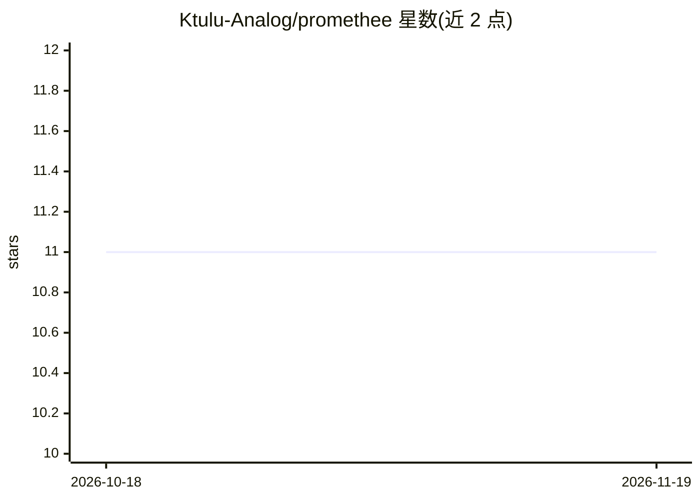

# Ktulu-Analog/promethee

⭐ 11 · Python · AGPL-3.0 · 推送 2026-05-29 · [GitHub](https://github.com/Ktulu-Analog/promethee) · 组织维护

**自托管企业级 AI 助手：RAG+工具调用+法国法律API**

自托管的 Web AI 助手，面向无法或不愿使用第三方云服务的专业环境。后端 FastAPI、前端 React，接入任意 OpenAI 兼容 LLM（含法国 DiNum 主权 API Albert）。LLM 可调用内置工具集：网页搜索、Tesseract OCR、办公文件导出、数据分析、IMAP/SMTP 邮件、Légifrance/Judilibre 法律 API、Grist 协作表格；另含 Qdrant 向量 RAG、加密会话历史、长期记忆、每用户隔离的虚拟文件系统（Garage S3 存储），并支持 LLM 在运行中生成新工具。提供 venv 开发模式与 Docker Compose 生产部署两种方式。

## 筛选速览

| 维度 | 判定 | 备注 |
|---|---|---|
| AI 角色 | `ai-native` | 本体是模型或模型工具 |
| 许可风险 | `viral` | AGPL-3.0 |
| 部署形态 | `self-host` | docker 或自建部署 |
| 模型依赖 | — | README 未给出锁定关系 |
| 硬件要求 | — | 无带数字的原话,不猜 |
| 安装摩擦 | `low` | 无编译、无系统依赖或容器化 |
| 成熟度 | — | 结构信号不足 |

## 能力要点

- 内置 13 类 LLM 可调用工具，含 Légifrance/Judilibre 法律 API（PISTE）
- Qdrant 向量 RAG 与会话长期记忆（LTM）
- 每用户隔离的虚拟文件系统，存储于 Garage S3
- 聊天内本地渲染 LaTeX（KaTeX）、Mermaid 与 ECharts 图表

## 适用场景

- 在无法使用外部云的内网环境部署合规 AI 助手
- 查询与检索法国法律法规文本（Légifrance/Judilibre）
- 对 CSV/Excel 数据做分析并生成图表与文档导出
- 接入邮箱与 Grist 表格的日常办公辅助

## 场景标签

`AI 助手` `RAG` `数据分析` `科研工具` · 领域:效率与自动化

## 证据(README 行号)

> L12: Prométhée est un assistant IA web auto-hébergé, pensé pour les environnements professionnels qui ne peuvent pas — o
> L14: Ce qui le distingue : une suite d'outils directement activables par le LLM — recherche web, OCR, export bureautique

## 星数曲线

2026-10-18 11 → 2026-11-19 11（+0）

---
*卡片 v1 · prompt 1.4 · 生成 2026-11-19 · 置信度 high · 依据 README sha `5046ac83a80f` · [字段定义](../../DATASET.md)*
