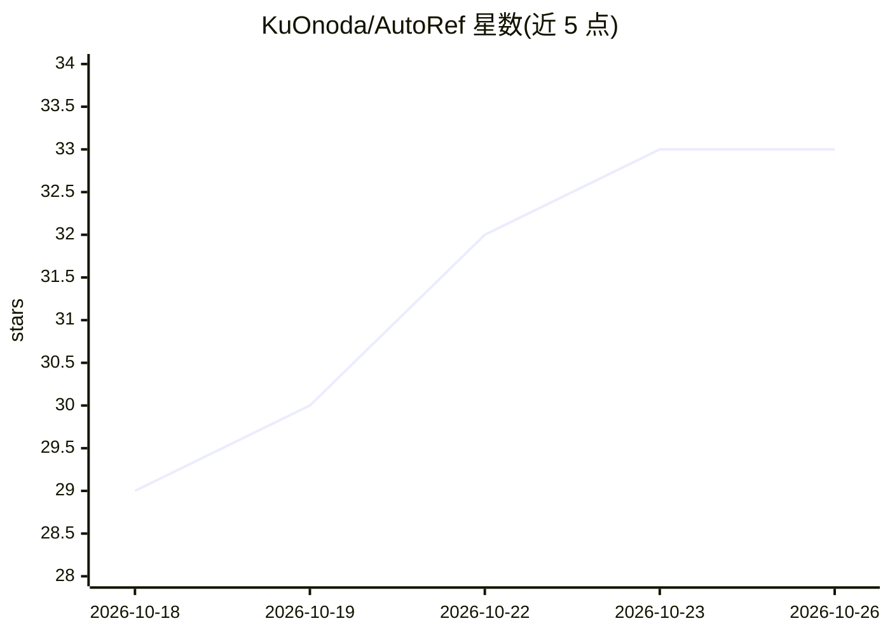

# KuOnoda/AutoRef

⭐ 33 · Python · MIT · 推送 2026-09-29 · [GitHub](https://github.com/KuOnoda/AutoRef) · 组织维护

**论文实现：优化多参考图像生成的 harness，无需训练生成器**

论文 "Harness Optimization for Agentic Multi-Reference Image Generation" 的官方实现。核心思想是不训练图像生成器，而是优化其外层的 harness 程序：由编码 agent（Claude Code）以束搜索迭代写出 harness 代码，在未见验证任务上筛选。产出的 AutoRef-Harness 围绕冻结生成器（FLUX.2 [klein] 4B/9B、Qwen-Image-Edit-2511）与推理模型（GPT-5.5）执行：改写提示词、生成结构多样的草稿、失败感知筛选与按投诉修订。运行搜索需 CUDA GPU（48GB）、Claude Code CLI 与带 GPU 的 Docker。

## 筛选速览

| 维度 | 判定 | 备注 |
|---|---|---|
| AI 角色 | `ai-native` | 本体是模型或模型工具 |
| 许可风险 | `permissive` | MIT |
| 部署形态 | `self-host` | docker 或自建部署 |
| 模型依赖 | locked-api |  |
| 硬件要求 | — | 无带数字的原话,不猜 |
| 安装摩擦 | `low` | 无编译、无系统依赖或容器化 |
| 成熟度 | — | 结构信号不足 |

## 能力要点

- 不训练生成器，通过编码 agent 束搜索自动优化 harness 代码
- AutoRef-Harness 将 FLUX.2 [klein] 4B 从 5.72 提升到 7.37（held-out MultiBanana）
- 支持 FLUX.2 [klein] 9B 与 Qwen-Image-Edit-2511 生成器，可迁移到未见参考数
- 搜索过程支持中断恢复，结果与日志写入 outputs/

## 适用场景

- 多张参考图合成一张符合指令的图像
- 复现论文的 harness 搜索流程与 MultiBanana 评测
- 在自有多参考图像生成任务上自动优化 harness

## 场景标签

`图像生成` · 领域:内容生成

## 证据(README 行号)

> L25: **AutoRef** improves a generator without training it. It optimizes the **harness**: the program
> L67: python -m autoref.generate --refs dog.png hat.png beach.png \

## 星数曲线

2026-10-18 29 → 2026-10-26 33（+4）

---
*卡片 v1 · prompt 1.4 · 生成 2026-10-25 · 置信度 mid · 依据 README sha `ae5cc66ba44d` · [字段定义](../../DATASET.md)*
