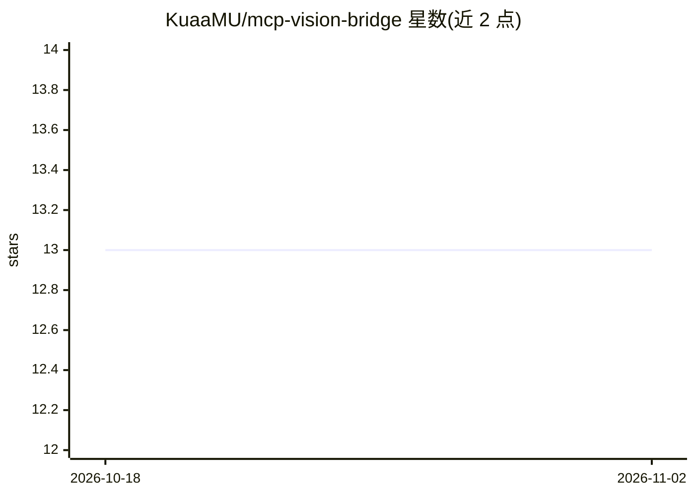

# KuaaMU/mcp-vision-bridge

⭐ 13 · TypeScript · MIT · 推送 2026-08-08 · [GitHub](https://github.com/KuaaMU/mcp-vision-bridge) · 个人维护 · 中文 README

**给纯文本编码 agent 添加视觉能力的 MCP 服务器**

一个 stdio MCP 服务器：当文本型编码 agent（Claude Code、Codex、opencode、Kimi 等）无法读图时，通过 analyze_image 工具把图像发送给用户自选的多模态模型（OpenAI 兼容接口、Anthropic、Gemini），返回逐字文本、布局、颜色等描述。图像本身不进入 agent 上下文。由 MCP 工具、技能（skill）与粘贴捕获 hook 三部分组成，可自动发现各 agent 会话中粘贴的图片；无内置 OCR 引擎，识读由所接入的视觉模型完成。需 Node.js ≥ 18，通过 Claude Code 插件、install.sh 脚本或手动 npx 配置安装。

## 筛选速览

| 维度 | 判定 | 备注 |
|---|---|---|
| AI 角色 | `ai-ecosystem` | LLM/agent 周边工具 |
| 许可风险 | `permissive` | MIT |
| 部署形态 | `library` | 以包/库形式分发 |
| 模型依赖 | — | README 未给出锁定关系 |
| 硬件要求 | — | 无带数字的原话,不猜 |
| 安装摩擦 | `low` | 无编译、无系统依赖或容器化 |
| 成熟度 | — | 结构信号不足 |

## 能力要点

- analyze_image 工具支持路径/URL/剪贴板/session 等多种图像来源与多图批量分析
- 自动发现 Claude Code、Codex、opencode 等六种 agent 会话中粘贴的图片
- 通过环境变量接入 OpenAI 兼容/Anthropic/Gemini 视觉模型
- 插件捆绑 MCP 服务器 + 技能 + 自动触发 hook 并自同步更新

## 适用场景

- 让纯文本编码 agent 读取报错截图并修复问题
- 调试时让 agent 对比多张 UI 截图找差异
- 从截图中提取文字内容交给编码 agent 处理

## 场景标签

`多模态` `OCR` · 领域:感知与多模态

## 证据(README 行号)

> L9: DeepSeek V4 Flash writes great code — but it can't *see* the error dialog, the broken UI, or the screenshot you just
> L140: - **MCP tool** (`analyze_image`) — the capability. Sends pixels to your vision model, returns text.

## 星数曲线

2026-10-18 13 → 2026-11-02 13（+0）

---
*卡片 v1 · prompt 1.4 · 生成 2026-10-31 · 置信度 high · 依据 README sha `afd20ba1466b` · [字段定义](../../DATASET.md)*
