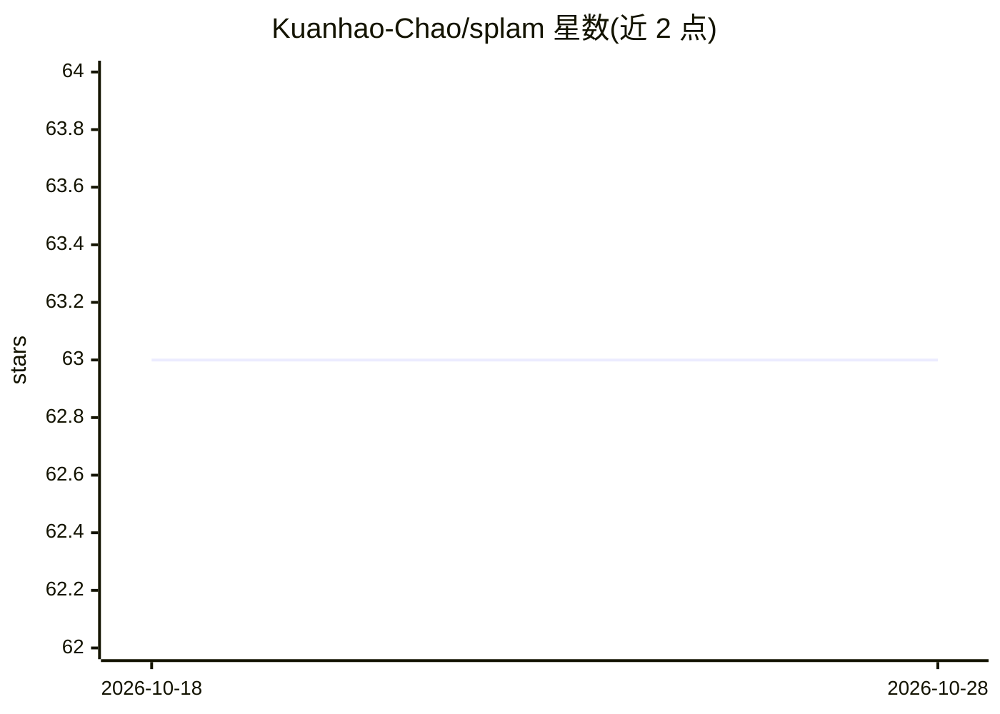

# Kuanhao-Chao/splam

⭐ 63 · C++ · 推送 2026-07-29 · [GitHub](https://github.com/Kuanhao-Chao/splam) · [官网](https://khchao.com/splam/) · 组织维护

**深度学习剪接位点预测器，评估并清理 RNA-Seq 剪接比对**

Splam 利用深度残差卷积神经网络，仅基于剪接供体/受体位点两侧各 400nt 的 DNA 序列对剪接位点打分。面向 RNA-Seq 数据分析人员：可评估 BAM 比对文件中剪接比对质量并移除含虚假剪接位点的比对，以提升下游转录本组装质量；也可对 GFF 注释文件或组装转录本中的内含子质量评分。命令行工具 splam 提供 extract/score/clean 子命令，支持在非人类物种上运行。以 pip 安装的 Python 包形式提供，附 Google Colab 示例。

## 筛选速览

| 维度 | 判定 | 备注 |
|---|---|---|
| AI 角色 | `ai-native` | 本体是模型或模型工具 |
| 许可风险 | `permissive` | — |
| 部署形态 | `library` | 以包/库形式分发 |
| 模型依赖 | — | README 未给出锁定关系 |
| 硬件要求 | — | 无带数字的原话,不猜 |
| 安装摩擦 | `low` | 无编译、无系统依赖或容器化 |
| 成熟度 | — | 结构信号不足 |

## 能力要点

- 深度残差 CNN 基于供体/受体位点 400nt 序列给剪接位点打分
- 清理 BAM 中含虚假剪接位点的比对，改善下游转录本组装
- 评估 GFF 注释或组装转录本的内含子与 isoform 质量
- 提供 splam extract/score/clean 子命令与 Colab 示例

## 适用场景

- 清理 RNA-Seq 比对文件中的虚假剪接比对
- 评估注释文件或组装转录本的内含子质量
- 在非人类物种数据上评分剪接位点

## 场景标签

 · 领域:生物信息学/基因组学

## 证据(README 行号)

> L5:  Splam is a splice site predictor utilizing a deep residual convolutional neural network for fast and accurate evalu
> L15: 1. **We need a tool to evaluate splice junctions & spliced alignments.** Thousands of RNA-Seq datasets are generate

## 星数曲线

2026-10-18 63 → 2026-10-28 63（+0）

---
*卡片 v1 · prompt 1.4 · 生成 2026-10-24 · 置信度 high · 依据 README sha `135667902f2a` · [字段定义](../../DATASET.md)*
