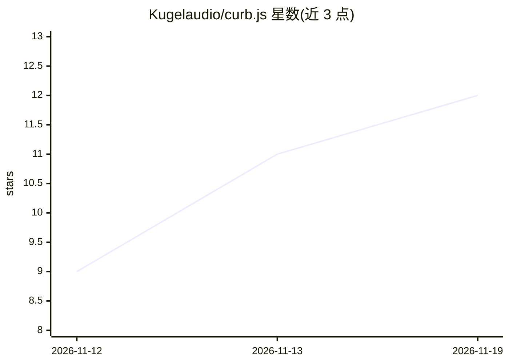

# Kugelaudio/curb.js

⭐ 12 · TypeScript · Apache-2.0 · 推送 2026-11-16 · [GitHub](https://github.com/Kugelaudio/curb.js) · [官网](https://curbjs.com) · 组织维护

**生产级语音 agent 框架：用 React 组件写提示与工具**

面向开发者的语音对话 agent 框架：开发者以 React 组件描述 agent 的系统提示、知识与工具，框架负责渲染为模型请求，并处理语音转文本、LLM 调用、文本转语音、轮次与打断等通话逻辑。内置预览、类型检查、终端单轮模拟与整段对话测试命令，支持任意 MCP 服务器的工具接入。默认由 KugelAudio 承载语音链路，也可用自有 LiveKit 与 provider 密钥自托管；API 仍在变动中，许可证为 Apache 2.0。

## 筛选速览

| 维度 | 判定 | 备注 |
|---|---|---|
| AI 角色 | `ai-ecosystem` | LLM/agent 周边工具 |
| 许可风险 | `permissive` | Apache-2.0 |
| 部署形态 | `library` | 以包/库形式分发 |
| 模型依赖 | — | README 未给出锁定关系 |
| 硬件要求 | — | 无带数字的原话,不猜 |
| 安装摩擦 | `low` | 无编译、无系统依赖或容器化 |
| 成熟度 | `idea` | |

## 能力要点

- React 组件即提示：状态变化实时改变模型可见的指令与工具
- Skills 按需加载，50 个技能仍保持小 prompt
- 提供商通过 prop 一行切换（Anthropic/OpenAI/Azure/Deepgram/ElevenLabs/Cartesia 等）
- npx curb test/say/check 支持无麦克风对话测试与类型检查

## 适用场景

- 开发可接电话的语音客服/接待 agent 并在上线前模拟对话测试
- 用 Claude Code 或 Cursor 让编码 agent 从真实通话中迭代改进 agent
- 在自己的服务器上用自有 LiveKit 与密钥自托管语音 agent

## 场景标签

`Agent 框架` `语音 Agent` · 领域:Agent 开发

## 证据(README 行号)

> L3:  The framework for production voice agents.
> L69: - **Your components are the prompt.** Curb renders them the way React renders UI, and the output
> L106: A Curb agent runs anywhere Node runs, with your own LiveKit and your own provider keys: set

## 星数曲线

2026-11-12 9 → 2026-11-19 12（+3）

---
*卡片 v1 · prompt 1.4 · 生成 2026-11-19 · 置信度 high · 依据 README sha `e871af936f61` · [字段定义](../../DATASET.md)*
