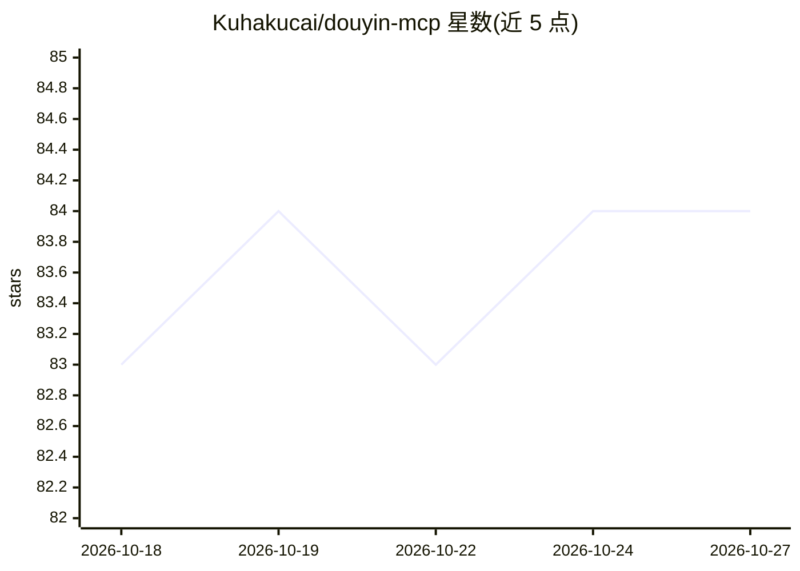

# Kuhakucai/douyin-mcp

⭐ 84 · Python · AGPL-3.0 · 推送 2026-07-29 · [GitHub](https://github.com/Kuhakucai/douyin-mcp) · 个人维护 · 中文 README

**本地运行的抖音创作者数据 MCP Server，供 AI 读取并复盘作品表现**

面向个人抖音创作者的本地 MCP Server：通过 Playwright 操作项目专用 Chrome，读取创作者中心页面真实可见的作品列表与经营指标（播放、点赞、完播率、涨粉等），存入本地 SQLite，再经 FastMCP 暴露 13 个数据工具和 9 个视频文案流水线工具给支持 MCP 的 AI Agent。可选功能用本地 faster-whisper 提取公开视频音轨文案（带时间戳），按需加载、不全量回溯。限制：非官方工具，macOS/Windows 单账号本机运行，不绕过登录与风控；结果附缓存新鲜度与覆盖率，未显示值存 null。

## 筛选速览

| 维度 | 判定 | 备注 |
|---|---|---|
| AI 角色 | `ai-ecosystem` | LLM/agent 周边工具 |
| 许可风险 | `dual` | AGPL-3.0 |
| 部署形态 | `desktop` | 安装包/桌面程序 |
| 模型依赖 | — | README 未给出锁定关系 |
| 硬件要求 | — | 无带数字的原话,不猜 |
| 安装摩擦 | `medium` | 含编译或系统依赖之一 |
| 成熟度 | — | 结构信号不足 |

## 能力要点

- Playwright 复用专用 Chrome 登录状态，增量同步页面可见指标到本地 SQLite
- 可选 faster-whisper 本地 ASR 提取公开视频音轨文案，按需加载不全量回溯
- 22 个 MCP 工具覆盖同步、查询、对比、复盘、导出与文案任务管理
- 结论附采集时间、覆盖率、缺失原因与质量警告，未显示值存 null 不猜测

## 适用场景

- 让 AI Agent 查询并对比我最近 30 天作品的表现指标
- 结合视频音轨文案与数据复盘选题、开头钩子与内容结构
- 导出全部历史作品快照为 JSON 或 CSV 做进一步分析

## 场景标签

`数据分析` · 领域:效率与自动化

## 证据(README 行号)

> L29: `douyin-mcp` 在你的电脑上复用专用 Chrome 登录状态，将抖音创作者中心页面中真实可见的作品、经营指标和公开视频音轨文案保存到本地 SQLite，再通过 MCP 提供给支持 MCP 的 AI Agent。AI 不仅
> L325: 3. **MCP 层**：FastMCP 暴露同步、查询、对比和复盘工具，Agent 不需要直接操作 Cookie 或理解页面 DOM。
> L323: 1. **浏览器层**：Playwright 操作项目专用 Chrome，读取用户在创作者中心页面中真实可见的内容，不能绕过登录、权限或平台验证。

## 星数曲线

2026-10-18 83 → 2026-10-27 84（+1）

---
*卡片 v1 · prompt 1.4 · 生成 2026-10-24 · 置信度 high · 依据 README sha `fbabe1840d49` · [字段定义](../../DATASET.md)*
