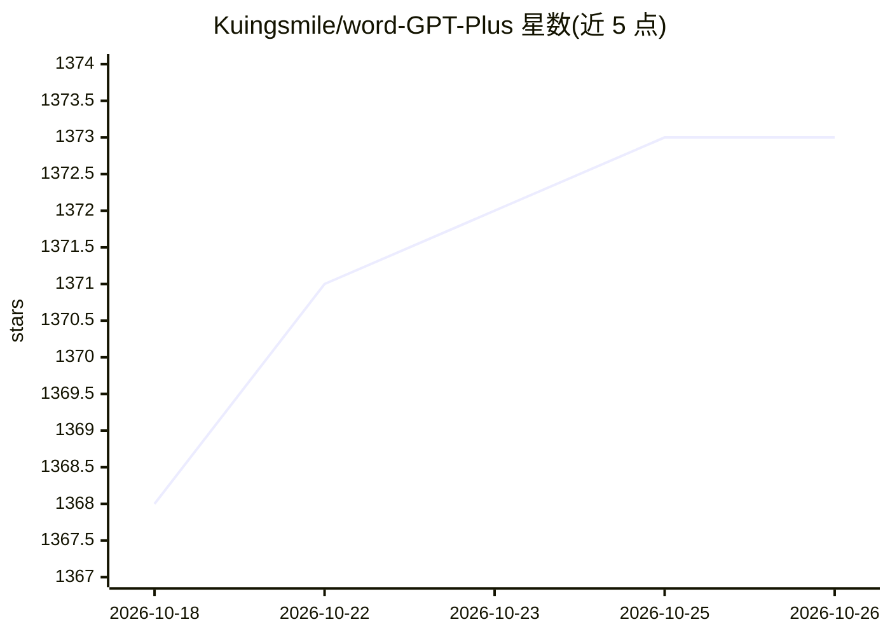

# Kuingsmile/word-GPT-Plus

⭐ 1,373 · TypeScript · MIT · 推送 2026-10-23 · [GitHub](https://github.com/Kuingsmile/word-GPT-Plus) · 个人维护 · 中文 README

**在 Microsoft Word 内直接使用 AI 与 Agent 的办公插件**

Word GPT Plus 是一个 Microsoft Word 加载项（add-in），把 AI 对话与 Agent 能力嵌入 Word 界面：Chat 模式做问答、翻译（40+ 语言）、润色、学术增强、摘要与语法检查；Agent 模式（基于 LangChain）通过 25+ 工具直接读写 Word 文档，包括插入/替换文本、创建表格、书签、格式化与搜索替换。支持 OpenAI（兼容 DeepSeek 等接口）、Azure OpenAI、Google Gemini、Ollama（本地部署）与 Groq，可自定义模型名、base URL 与代理。API key 存本地不经过中间服务器。要求 Word 2016+/Microsoft 365 与 Edge WebView2 Runtime，仅支持 .docx。提供免编码 manifest 侧载、Docker 自托管与源码构建三种安装方式。

## 筛选速览

| 维度 | 判定 | 备注 |
|---|---|---|
| AI 角色 | `ai-native` | 本体是模型或模型工具 |
| 许可风险 | `permissive` | MIT |
| 部署形态 | `self-host` | docker 或自建部署 |
| 模型依赖 | local-ok | 支持本地模型 |
| 硬件要求 | — | 无带数字的原话,不猜 |
| 安装摩擦 | `low` | 无编译、无系统依赖或容器化 |
| 成熟度 | — | 结构信号不足 |

## 能力要点

- Agent 模式通过 25+ 工具直接读写和格式化 Word 文档
- 支持 OpenAI/Azure/Gemini/Ollama/Groq 多平台并兼容自定义模型与 base URL
- 一键翻译（40+ 语言）、润色、学术增强、摘要、语法检查快捷操作
- API key 与提示词存储于本地，直连 AI 提供商

## 适用场景

- 写论文或报告时在 Word 内直接让 AI 润色、翻译和摘要
- 让 Agent 读全文档并自动生成摘要、统一标题格式或插入表格
- 通过本地 Ollama 在 Word 内离线使用 AI 功能

## 场景标签

`AI 写作` `AI 助手` · 领域:对话与助手

## 证据(README 行号)

> L28: Word GPT Plus seamlessly integrates AI and Agent directly into Microsoft Word, allowing you to generate, translate,
> L42: - **Intelligent Agent Mode** (Powered by LangChain):

## 星数曲线

2026-10-18 1,368 → 2026-10-26 1,373（+5）

---
*卡片 v1 · prompt 1.4 · 生成 2026-10-21 · 置信度 mid · 依据 README sha `0f26efddfad4` · [字段定义](../../DATASET.md)*
