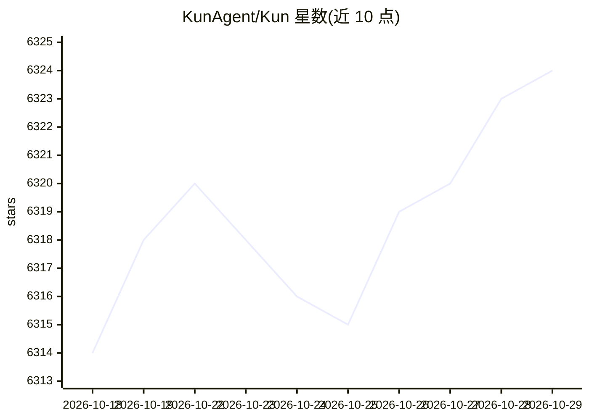

# KunAgent/Kun

⭐ 6,324 · TypeScript · NOASSERTION · 推送 2026-10-27 · [GitHub](https://github.com/KunAgent/Kun) · [官网](https://www.kun-agent.com) · 组织维护 · 中文 README

**本地优先的桌面 AI 工作台：写代码、做文档、跑 Agent**

跑在本机的 Electron 桌面应用，代码、文档与 Agent 对话共用一个本地运行时（kun serve），GUI 与终端 TUI 均可连接。Code 界面集成项目、终端、Git、Diff 与 Design 画布；Work 界面管理文档与论文；可与个人 Agent、Codex、Claude Code、OpenCode 对话或拉群。模型由用户自行接入，支持 OpenAI/Anthropic 兼容接口与 DeepSeek、Kimi、GLM、Qwen、Ollama 等预设；会话与记忆存本地，工具调用默认需批准。采用 PolyForm Noncommercial 许可，商业使用需作者书面授权。

## 筛选速览

| 维度 | 判定 | 备注 |
|---|---|---|
| AI 角色 | `ai-native` | 本体是模型或模型工具 |
| 许可风险 | `none` | NOASSERTION |
| 部署形态 | `desktop` | 安装包/桌面程序 |
| 模型依赖 | — | README 未给出锁定关系 |
| 硬件要求 | — | 无带数字的原话,不猜 |
| 安装摩擦 | `low` | 无编译、无系统依赖或容器化 |
| 成熟度 | — | 结构信号不足 |

## 能力要点

- 代码/文档/Agent 对话共用一个本地运行时，GUI 与 TUI 共享线程与审批
- 本地网关统一管理 Provider 配置，支持 OpenAI/Anthropic 兼容接口与本地模型
- 插件与技能市场（MCP / Skills）、提醒定时任务、手机远程
- 提供 macOS/Windows/Linux 安装包

## 适用场景

- 在本机一站式写代码、管理文档并与多个 Agent 协作
- 不让数据出本机的前提下使用云端或本地模型
- 在终端 TUI 里继续桌面端的任务与审批流程

## 场景标签

`多智能体` `编码 Agent` `AI 助手` `知识库管理` · 领域:Agent 开发

## 证据(README 行号)

> L23: Kun 是跑在你电脑上的桌面应用。代码、文档和 Agent 对话共用一个本地运行时；会话、记忆和设置都留在本机，模型由你自己接入。
> L28:  Agent 对话：和个人 Agent、Codex、Claude Code、OpenCode 私聊或拉群
> L36: 2. **连接一个模型。** 首次启动的引导里填 API Key，或登录已有订阅。支持 OpenAI / Anthropic 兼容接口与本地模型，见 Provider 文档。

## 星数曲线

2026-10-18 6,314 → 2026-10-29 6,324（+10）

---
*卡片 v1 · prompt 1.4 · 生成 2026-10-20 · 置信度 high · 依据 README sha `5d858dab05fd` · [字段定义](../../DATASET.md)*
