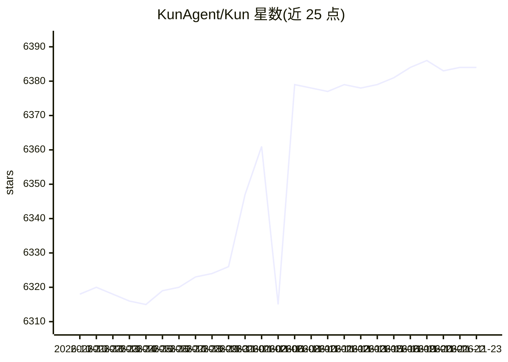

# KunAgent/Kun

⭐ 6,384 · TypeScript · NOASSERTION · 推送 2026-11-22 · [GitHub](https://github.com/KunAgent/Kun) · [官网](https://www.kun-agent.com) · 组织维护 · 中文 README

**本地优先桌面 AI 工作台：写代码、文档、设计与 Agent 协作**

跑在本机的 Electron 桌面应用，Code、Work、对话共用一个本地运行时：项目/终端/Git/Diff、Design 画布、论文库、报告产物库集中在一处。可把任务分派给个人 Agent 或外部 Agent（Claude Code、Codex、OpenCode）协作。会话、记忆、设置留在本地，工具执行默认需批准；模型由用户自行接入，提供本地网关复用同一份 Provider 配置。GUI 与 TUI 共用同一运行时。PolyForm Noncommercial 许可，商业使用需授权。

## 筛选速览

| 维度 | 判定 | 备注 |
|---|---|---|
| AI 角色 | `ai-ecosystem` | LLM/agent 周边工具 |
| 许可风险 | `none` | NOASSERTION |
| 部署形态 | `desktop` | 安装包/桌面程序 |
| 模型依赖 | local-ok | 支持本地模型 |
| 硬件要求 | — | 无带数字的原话,不猜 |
| 安装摩擦 | `low` | 无编译、无系统依赖或容器化 |
| 成熟度 | — | 结构信号不足 |

## 能力要点

- GUI 与 TUI 共用同一 kun serve 运行时
- 多 Agent 协作：与个人 Agent、Claude Code、Codex、OpenCode 私聊或拉群
- Design 画布方案确认后交给 Agent 实现
- 本地数据存储、工具执行默认需批准

## 适用场景

- 在本机用一个工作区同时管代码、文档和论文
- 把任务分派给多个 Agent 并跟踪进展
- 接入自定义或本地模型做日常编码与写作

## 场景标签

`AI 助手` `编码 Agent` `多智能体` `AI 写作` · 领域:Agent 开发

## 证据(README 行号)

> L23: Kun 是跑在你电脑上的桌面应用。Code、Work 和对话共用一个本地运行时：写代码、做设计、处理文档和论文，也能把任务交给不同的 Agent 协作完成。会话、记忆和设置留在本机，模型由你自己接入。
> L29:  模型与网关：接入任意兼容 Provider，本地网关复用同一份配置

## 星数曲线

2026-10-21 6,318 → 2026-11-23 6,384（+66）

---
*卡片 v1 · prompt 1.4 · 生成 2026-11-22 · 置信度 high · 依据 README sha `cb28a403fbee` · [字段定义](../../DATASET.md)*
