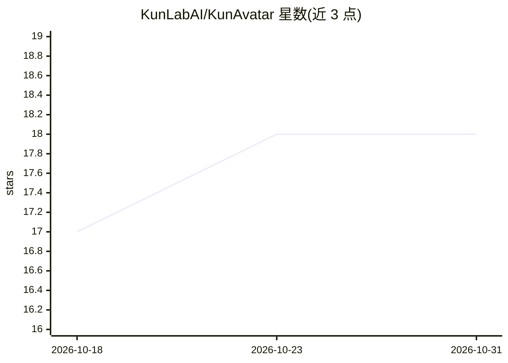

# KunLabAI/KunAvatar

⭐ 18 · TypeScript · NOASSERTION · 推送 2025-12-10 · [GitHub](https://github.com/KunLabAI/KunAvatar) · [官网](https://kunlabai.com) · 组织维护 · 中文 README

**基于 Ollama 的本地部署 AI 对话客户端，带 MCP 与记忆**

以 Ollama 为推理引擎的本地部署 AI 客户端（Web 端，桌面客户端在路线图中）：提供流式对话、多模型热切换、多模态图片对话；递归式记忆系统支持上下文记忆与记忆模型；集成 MCP 工具调用（stdio/SSE/Streamable HTTP 三种传输）；企业级 RBAC 权限与多租户管理。前端为 Next.js 15 + React 19，数据用 SQLite 存储。安装需 Node.js >= 22.15.0 与 Ollama >= 0.9.6，通过 git clone + npm 构建，README 注明目前只支持 Windows。

## 筛选速览

| 维度 | 判定 | 备注 |
|---|---|---|
| AI 角色 | `ai-native` | 本体是模型或模型工具 |
| 许可风险 | `none` | NOASSERTION |
| 部署形态 | `library` | 以包/库形式分发 |
| 模型依赖 | local-ok | 支持本地模型 |
| 硬件要求 | — | 无带数字的原话,不猜 |
| 安装摩擦 | `low` | 无编译、无系统依赖或容器化 |
| 成熟度 | — | 结构信号不足 |

## 能力要点

- 以 Ollama 为核心推理引擎，兼容所有 Ollama 模型并支持热切换
- MCP 工具集成，支持 stdio/SSE/Streamable HTTP 三种传输协议
- 递归式记忆系统与辅助模型（提示词优化、标题摘要、记忆模型）
- RBAC 权限体系与多租户管理，数据本地化存储

## 适用场景

- 在本地与 Ollama 模型对话，数据不出本机
- 通过 MCP 服务器让 AI 调用外部工具
- 团队或企业在局域网内部署带权限管控的 AI 对话服务

## 场景标签

`聊天机器人` `Agent 记忆` · 领域:Agent 开发

## 证据(README 行号)

> L12: KunAvatar 是一款支持本地部署的轻量级 AI 桌面客户端，以 Ollama 为核心推理引擎构建。该产品在完整保留 Ollama 原生功能的基础上，进一步扩展了多项高实用性能力：涵盖 RBAC 权限体系、多租户管理、对话记忆
> L92: - **Ollama** - 本地大语言模型运行时
> L21: - **📦 开箱即用** - 无需复杂配置，即可在本地部署和使用（目前只支持Windows）

## 星数曲线

2026-10-18 17 → 2026-10-31 18（+1）

---
*卡片 v1 · prompt 1.4 · 生成 2026-10-29 · 置信度 high · 依据 README sha `fba4174c2d5e` · [字段定义](../../DATASET.md)*
