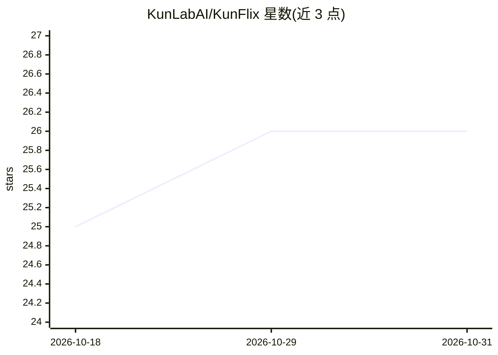

# KunLabAI/KunFlix

⭐ 26 · TypeScript · NOASSERTION · 推送 2026-10-25 · [GitHub](https://github.com/KunLabAI/KunFlix) · [官网](https://kunpuai.com/kunflix) · 组织维护 · 中文 README

**面向影视广告创作者的 AI 多智能体内容创作平台**

自托管的影视广告 AI 创作平台：基于 AgentScope 多智能体框架，在无限画布中以对话驱动剧本、角色、图像、视频、音乐的生成，生成内容自动存为可复用资产。后端 FastAPI + PostgreSQL，前端 Next.js，提供 dev.py 本地开发、Docker 与云服务器三种启动方式（PostgreSQL 缺失时可自动降级 SQLite）。支持在管理后台配置 OpenAI、Gemini、xAI、DeepSeek、Ollama 等十余家供应商 API Key，含积分计费、用户管理与 Agent 监控。Apache 2.0 附加条款，二次开发等情形需商业授权。

## 筛选速览

| 维度 | 判定 | 备注 |
|---|---|---|
| AI 角色 | `ai-native` | 本体是模型或模型工具 |
| 许可风险 | `none` | NOASSERTION |
| 部署形态 | `self-host` | docker 或自建部署 |
| 模型依赖 | local-ok | 支持本地模型 |
| 硬件要求 | — | 无带数字的原话,不猜 |
| 安装摩擦 | `low` | 无编译、无系统依赖或容器化 |
| 成熟度 | — | 结构信号不足 |

## 能力要点

- 剧本→角色→视音频→成片的多模态生成链路
- 对话驱动的多智能体协作与可扩展 Skills 系统
- 支持 OpenAI/Gemini/xAI/DeepSeek/Ollama 等十余家 AI 供应商接入
- dev.py 一键启动，PostgreSQL 缺失可自动降级 SQLite

## 适用场景

- 短剧、品牌广告片、MV 的全流程 AI 创作
- 在无限画布中通过对话让智能体生成图像、视频与音乐
- 广告团队批量生产竖屏短视频素材

## 场景标签

`多智能体` `多模态` `图像生成` `视频生成` · 领域:Agent 开发

## 证据(README 行号)

> L24: KunFlix 是一款**专注于影视广告的AI内容创作Agent平台**，将剧本写作、角色设计、视音频生成、资产管理和智能剪辑全链路打通，让创作者、广告公司和品牌方像拥有一个"私人好莱坞团队"一样，高效完成从0到1的完整影视作品。
> L37: ### 🎨 全链路多模态
> L55: |🎬 **多媒体制作**|视频生成、动画短片、短剧成片、广告宣传片|

## 星数曲线

2026-10-18 25 → 2026-10-31 26（+1）

---
*卡片 v1 · prompt 1.4 · 生成 2026-10-27 · 置信度 mid · 依据 README sha `0315a3fd92a4` · [字段定义](../../DATASET.md)*
