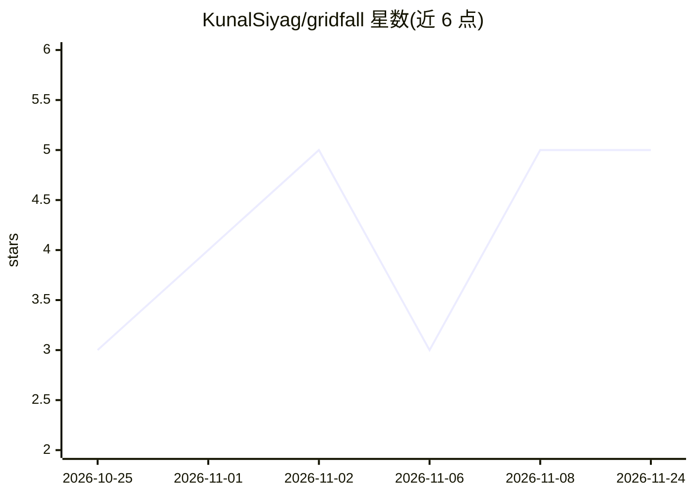

# KunalSiyag/gridfall

⭐ 5 · GDScript · MIT · 推送 2026-11-16 · [GitHub](https://github.com/KunalSiyag/gridfall) · [官网](https://kunalsiyag.github.io/gridfall/) · 个人维护

**由 5 个 AI 市长与约 100 个 AI 居民驱动的 SimCity 式城市模拟**

基于 Godot 4.7 的 3D 城市建造模拟游戏：玩家不建造城市，而是观察并干预由 AI 驱动的城市。5 个市长各绑定一个不同模型，每日接收 ASCII 地图与城市统计后以 JSON 回复行动（道路、分区、建造、税收、法令等），模拟器校验并拒绝非法行动；约 100 个居民由模型决定通勤、消费、抗议等行为，交通与税收由这些决策产生。推理依赖 GMI Cloud（14 个聊天模型与图像模型），另用 ACE-Step 生成音频；提供模型行为账本、投票板等可视化面板，未设置 API key 时以 FALLBACK 标记展示。

## 筛选速览

| 维度 | 判定 | 备注 |
|---|---|---|
| AI 角色 | `ai-native` | 本体是模型或模型工具 |
| 许可风险 | `permissive` | MIT |
| 部署形态 | `desktop` | 安装包/桌面程序 |
| 模型依赖 | — | README 未给出锁定关系 |
| 硬件要求 | — | 无带数字的原话,不猜 |
| 安装摩擦 | `low` | 无编译、无系统依赖或容器化 |
| 成熟度 | — | 结构信号不足 |

## 能力要点

- 5 个市长各由不同模型驱动，每日输出 JSON 格式的建造与施政决策
- 约 100 个 AI 居民的通勤/消费/迁徙决策生成交通与经济数据
- 模型账本与 League/Arena 面板按模型统计调用时长、命令接受率与失败数
- 无 API key 时所有卡片标记 LIVE/REPLAY/FALLBACK 状态

## 适用场景

- 观察不同 LLM 在同一城市模拟中的行为差异
- 以玩家法令干预 AI 市长的城市规划
- 研究 generative-agents 式多智能体模拟机制

## 场景标签

`多智能体` · 领域:Agent 开发

## 证据(README 行号)

> L7: **GridFall** is a 3D SimCity-style city builder made with **Godot 4.7** (Forward+ on desktop, Compatibility in the b
> L27: Once per in-game day, each mayor gets an ASCII map of its district, district and city stats, open lots, its open co

## 星数曲线

2026-10-25 3 → 2026-11-24 5（+2）

---
*卡片 v1 · prompt 1.4 · 生成 2026-11-21 · 置信度 high · 依据 README sha `7cdecf3291e6` · [字段定义](../../DATASET.md)*
