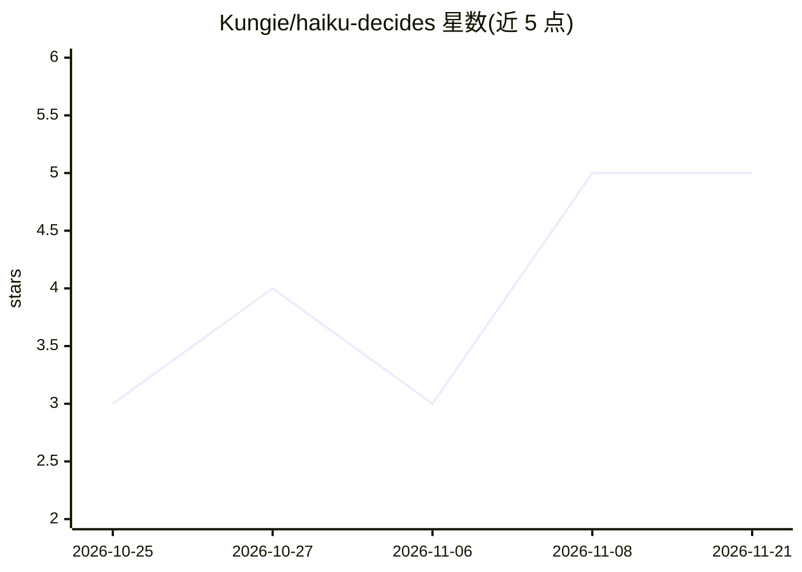

# Kungie/haiku-decides

⭐ 5 · Python · MIT · 推送 2026-10-08 · [GitHub](https://github.com/Kungie/haiku-decides) · 个人维护

**用 Claude Haiku 5.5 复现决策模型接口并与 Jev/OpenAI 对比评测的工具**

一个基准测试工具：决策模型对输入回答封闭问题并为每个选项返回概率，TypeSafe AI 的 Jev 与 OpenAI Decisions API 原生提供此接口，Anthropic 则没有；本项目在 Claude Haiku 5.5 上以三种模式（single/sampled/shuffled）模拟同一接口。在 Banking77、AG News、BoolQ、SMS Spam、SST-5 五个数据集上测量准确率、校准误差（ECE/Brier）、选项顺序敏感度、延迟与成本，附 95% bootstrap 区间与配对差异检验，可通过 CLI 复现完整评测。

## 筛选速览

| 维度 | 判定 | 备注 |
|---|---|---|
| AI 角色 | `ai-ecosystem` | LLM/agent 周边工具 |
| 许可风险 | `permissive` | MIT |
| 部署形态 | `library` | 以包/库形式分发 |
| 模型依赖 | locked-api |  |
| 硬件要求 | — | 无带数字的原话,不猜 |
| 安装摩擦 | `low` | 无编译、无系统依赖或容器化 |
| 成熟度 | — | 结构信号不足 |

## 能力要点

- 在 Haiku 5.5 上以三种模式模拟决策 API：单次调用、N 次采样投票、打乱选项顺序
- 测量准确率、校准误差（ECE 与 Brier 分数）、顺序敏感度、延迟与成本四类指标
- 结果附 95% bootstrap 区间与配对差异判定
- run 命令逐条追加 JSON 结果并支持中断续跑，测试无需 API key 与网络

## 适用场景

- 复现决策模型接口的横向基准对比
- 评估用 LLM 采样生成概率时的校准质量
- 对比原生决策 API 与自建方案的成本与延迟

## 场景标签

`模型评测` · 领域:评测与运维

## 证据(README 行号)

> L9: `haiku-decides` emulates the same interface on top of Claude Haiku 5.5 in three
> L97: Four things are measured:
> L116: ```bash

## 星数曲线



2026-10-25 3 → 2026-11-21 5（+2）


---
*卡片 v1 · prompt 1.4 · 生成 2026-11-21 · 置信度 high · 依据 README sha `f27f312477a5` · [字段定义](../../DATASET.md)*
