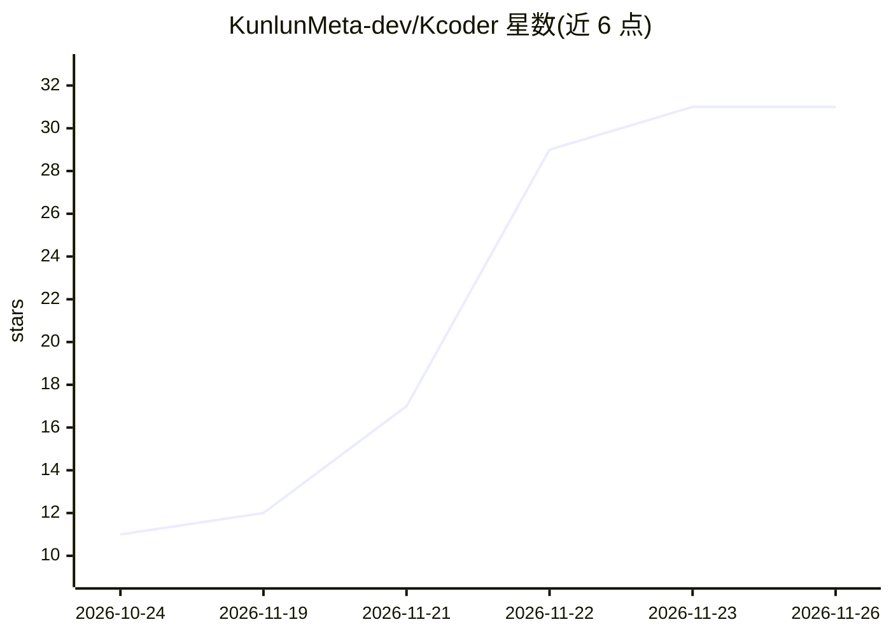

# KunlunMeta-dev/Kcoder

⭐ 31 · Rust · MIT · 推送 2026-11-25 · [GitHub](https://github.com/KunlunMeta-dev/Kcoder) · [官网](https://github.com/KunlunMeta-dev/Kcoder/releases) · 组织维护 · 中文 README

**面向开发者的 agentic 编码工作台：CLI/TUI 与桌面端运行 AI 任务**

昆仑元开发的智能体编码平台，提供 Studio 桌面应用与 CLI/TUI 两种入口。用户描述目标并附资料后，系统读取文件、运行工具、搜索网页并推进任务；内置 KWorker 资料处理模式、专家（可保存指令与技能的配置模板）、子代理拆解长程任务、工作流编排与定时执行、Wiki 与跨会话记忆，并支持飞书/QQ/微信等通讯渠道接入。Windows 提供安装包，Linux 需 Rust 1.95 从源码构建 CLI/TUI；模型服务需自行配置地址与凭证。

## 筛选速览

| 维度 | 判定 | 备注 |
|---|---|---|
| AI 角色 | `ai-native` | 本体是模型或模型工具 |
| 许可风险 | `permissive` | MIT |
| 部署形态 | `desktop` | 安装包/桌面程序 |
| 模型依赖 | — | README 未给出锁定关系 |
| 硬件要求 | — | 无带数字的原话,不猜 |
| 安装摩擦 | `low` | 无编译、无系统依赖或容器化 |
| 成熟度 | — | 结构信号不足 |

## 能力要点

- KCoder/KWorker 双模式：编码任务与资料整理任务分别处理
- 子代理拆解长程任务，工作流画布编排步骤与定时执行
- 支持从 Claude Code 或 Codex 迁入历史会话并接续工作
- 通过插件、Skills、MCP 扩展工具；Windows 桌面可授权使用 Computer Use

## 适用场景

- 让助手阅读修改项目文件、运行测试并解释失败原因
- 把会议纪要等资料整理成行动项和交付内容
- 把聊天消息绑定到已有任务，通过通讯渠道推进工作
- 外网设备经 Gateway/Relay 连回自己的主机执行任务

## 场景标签

`编码 Agent` `工作流自动化` `GUI 自动化` · 领域:效率与自动化

## 证据(README 行号)

> L14: KCoder 提供 Studio 图形界面和 CLI/TUI 终端入口。你可以描述目标、附上资料，让助手读取文件、运行工具、搜索网页并推进任务；也可以选择专家、复用工作流，或在原会话中继续已有工作。本机和远程运行目标分别管理模型、
> L29: - **推进长程任务**：将任务拆解给子代理，查看各自进度，在原会话中继续跟进和汇总结果。
> L41: |**KCoder**|编程、代码审查、项目维护和问题排查|“检查这次改动，运行相关测试并解释失败原因。”|

## 星数曲线

2026-10-24 11 → 2026-11-26 31（+20）

---
*卡片 v1 · prompt 1.4 · 生成 2026-11-19 · 置信度 high · 依据 README sha `83c1f2ef6e6b` · [字段定义](../../DATASET.md)*
