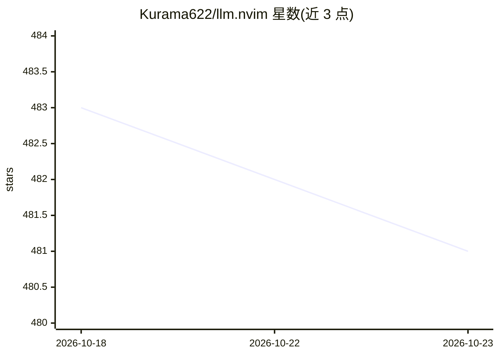

# Kurama622/llm.nvim

⭐ 481 · Lua · GPL-3.0 · 推送 2026-06-20 · [GitHub](https://github.com/Kurama622/llm.nvim) · 个人维护 · 中文 README

**在 Neovim 中与各类 LLM 对话的插件：聊天、翻译、代码优化**

Neovim 的 LLM 交互插件，支持接入 GPT、GLM、Kimi、DeepSeek、Gemini、Qwen 及 ollama 等本地模型，也可使用 Copilot、GitHub Models、SiliconFlow、OpenRouter、Cloudflare 等平台的免费模型。内置多种 AI 工具（handler）：聊天、解释/优化代码、生成测试用例、AI 翻译、图像识别、生成 Git commit 信息、文档字符串、代码补全与 Web 搜索，支持流式输出与 function-calling，可自定义流式/非流式解析函数。提供 Float/Split 两种 UI 与会话历史管理。使用前需设置 LLM_KEY 环境变量（本地模型设为 NONE），依赖 curl。

## 筛选速览

| 维度 | 判定 | 备注 |
|---|---|---|
| AI 角色 | `ai-native` | 本体是模型或模型工具 |
| 许可风险 | `viral` | GPL-3.0 |
| 部署形态 | `None` |  |
| 模型依赖 | local-ok | 支持本地模型 |
| 硬件要求 | — | 无带数字的原话,不猜 |
| 安装摩擦 | `low` | 无编译、无系统依赖或容器化 |
| 成熟度 | — | 结构信号不足 |

## 能力要点

- 支持任意 LLM 与本地模型（ollama 等），api_type 含 openai/zhipu/deepseek/ollama/copilot 等格式
- 多种 handler：聊天、代码优化（diff 展示）、测试用例生成、翻译、图像识别、commit 信息、文档字符串、代码补全
- 可自定义 AI 工具，不同工具可使用不同模型，支持 function-calling 与自定义流式解析
- 支持接入 LSP 与 diagnostic 上下文，提供 Float/Split 双 UI

## 适用场景

- 在 Neovim 内与 LLM 对话、提问并保留会话历史
- 对选中文本做翻译、解释、优化或生成测试用例
- 利用 GitHub Models、SiliconFlow 等平台的免费模型完成日常编码辅助
- 接入本地 ollama 模型做离线补全与对话

## 场景标签

`AI 助手` `代码生成` · 领域:编码与开发

## 证据(README 行号)

> L7: > A large language model(LLM) plugin that allows you to interact with LLM in Neovim.
> L9: > 1. Supports any LLM, such as GPT, GLM, Kimi, DeepSeek, Gemini, Qwen or local LLMs (such as ollama).
> L267: |completion_handler|Code completion|

## 星数曲线

2026-10-18 483 → 2026-10-23 481（-2）

---
*卡片 v1 · prompt 1.4 · 生成 2026-10-21 · 置信度 high · 依据 README sha `b4c75f7cdad1` · [字段定义](../../DATASET.md)*
