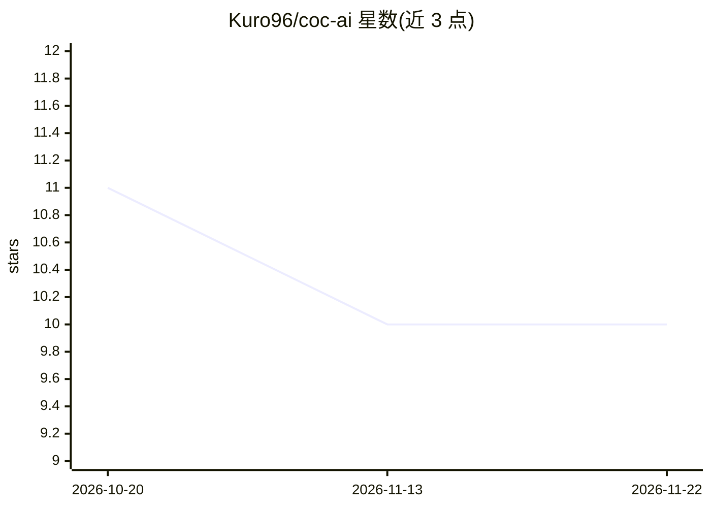

# Kuro96/coc-ai

⭐ 10 · TypeScript · MIT · 推送 2026-06-12 · [GitHub](https://github.com/Kuro96/coc-ai) · 个人维护 · 中文 README

**基于 coc.nvim 的 Vim/Neovim AI 代码助手插件**

vim-ai 的 fork，用 TypeScript 重写并接入 coc.nvim 扩展系统，为 Vim/Neovim 提供异步 AI 功能：对话（AIChat）、文本编辑（AIEdit）、补全（AIComplete）与 Tab 补全，支持自定义角色 TOML 配置与优先级覆盖。通过 OpenAI 兼容端点接入多家服务，提供 `:AIConfig` 交互式配置中心管理模型、端点、代理与认证，可经 OpenCode/Codex OAuth 复用 ChatGPT Plus/Pro 订阅。要求 Vim 9+ 与 Node 18+，依赖 coc.nvim，经 CocInstall 安装。

## 筛选速览

| 维度 | 判定 | 备注 |
|---|---|---|
| AI 角色 | `ai-native` | 本体是模型或模型工具 |
| 许可风险 | `permissive` | MIT |
| 部署形态 | `None` |  |
| 模型依赖 | — | README 未给出锁定关系 |
| 硬件要求 | — | 无带数字的原话,不猜 |
| 安装摩擦 | `low` | 无编译、无系统依赖或容器化 |
| 成熟度 | — | 结构信号不足 |

## 能力要点

- AIChat/AIEdit/AIComplete/AIStop 等 Vim 命令行 AI 工作流
- 自定义角色（TOML）与 role/chat/Coc 三级优先级配置
- 通过 Codex OAuth 复用 ChatGPT Plus/Pro 订阅模型
- AIConfig 交互式配置中心，管理 provider/model/auth

## 适用场景

- 在 Vim/Neovim 中与 LLM 对话解答编码问题
- 对选中文本或整个文件进行 AI 改写编辑
- 在编辑器内调用自定义 prompt 角色做代码补全
- 复用 ChatGPT 订阅在终端编辑器中调用模型

## 场景标签

`AI 助手` · 领域:对话与助手

## 证据(README 行号)

> L3: This project is a fork of vim-ai by madox2.
> L9: - Integrated with coc.nvim for async AI features.
> L20: 3. Use command `:CocInstall https://github.com/Kuro96/coc-ai` in your vim

## 星数曲线

2026-10-20 11 → 2026-11-22 10（-1）

---
*卡片 v1 · prompt 1.4 · 生成 2026-11-20 · 置信度 high · 依据 README sha `1ce5747db932` · [字段定义](../../DATASET.md)*
