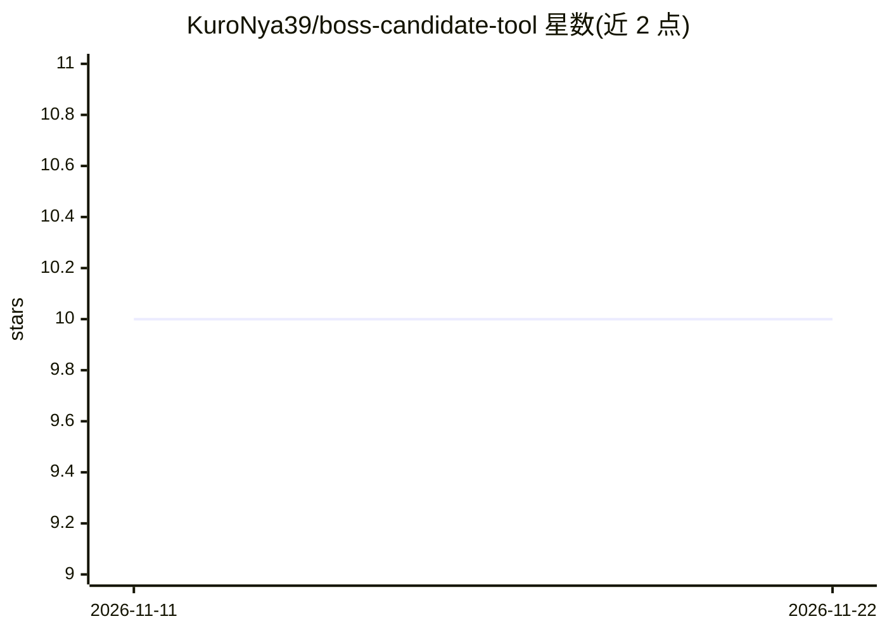

# KuroNya39/boss-candidate-tool

⭐ 10 · JavaScript · NOASSERTION · 推送 2026-11-17 · [GitHub](https://github.com/KuroNya39/boss-candidate-tool) · 个人维护 · 中文 README

**给招聘者：从 BOSS直聘提取简历并 AI 评分的桌面工具**

Windows 桌面应用（Electron + Node.js），通过 Chrome DevTools 协议控制用户的 Chrome 浏览器，从 BOSS直聘的推荐牛人页、搜索页、沟通页提取候选人信息与简历正文，按岗位要求调用 Anthropic 兼容格式的 AI 服务逐人打出 0-100 匹配分并生成评语，导出 Excel（可发邮箱），并支持自动给达标候选人打招呼。数据保存在本地；运行期间 Chrome 须保持前台标签页，非 VIP 账号每日可查看人数有限制。

## 筛选速览

| 维度 | 判定 | 备注 |
|---|---|---|
| AI 角色 | `ai-native` | 本体是模型或模型工具 |
| 许可风险 | `none` | NOASSERTION |
| 部署形态 | `desktop` | 安装包/桌面程序 |
| 模型依赖 | — | README 未给出锁定关系 |
| 硬件要求 | — | 无带数字的原话,不猜 |
| 安装摩擦 | `low` | 无编译、无系统依赖或容器化 |
| 成熟度 | — | 结构信号不足 |

## 能力要点

- 三种页面来源提取候选人简历，含直接文字、模拟复制与截图 OCR 三种方式
- 按岗位描述的评估维度与权重做 0-100 AI 评分并分五星档位
- 自动打招呼（仅推荐牛人页）与结果 Excel 邮件发送
- 候选人数据本地保存，AI 请求仅发送至用户配置的 API 地址

## 适用场景

- 批量从 BOSS直聘推荐页提取候选人并用 AI 初筛打分
- 把评分结果整理成 Excel 表发给团队或邮箱存档
- 对评分达标的候选人自动批量打招呼

## 场景标签

`OCR` `浏览器自动化` · 领域:效率与自动化

## 证据(README 行号)

> L5: 一个帮你「从 BOSS直聘招人」的桌面助手：它会帮你从 BOSS直聘提取候选人简历，把每位候选人的简历按岗位要求用 AI 评分，自动给分数达标的候选人打招呼，最后把所有结果整理成 Excel 表格发给你。
> L12: - **AI 评分**：按照岗位要求，给每位候选人打出 0-100 的匹配分，并写出评语
> L28: - AI 服务地址（Anthropic 兼容格式，首次使用时配置一次即可）

## 星数曲线

2026-11-11 10 → 2026-11-22 10（+0）

---
*卡片 v1 · prompt 1.4 · 生成 2026-11-20 · 置信度 mid · 依据 README sha `1b6dc4b8bceb` · [字段定义](../../DATASET.md)*
