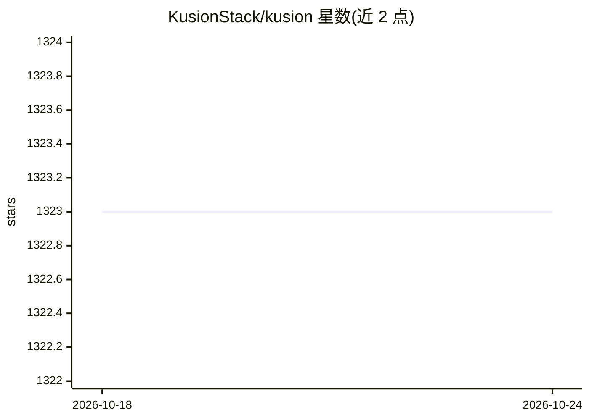

# KusionStack/kusion

⭐ 1,323 · Go · Apache-2.0 · 推送 2026-10-20 · [GitHub](https://github.com/KusionStack/kusion) · [官网](https://kusionstack.io) · 组织维护 · 中文 README

**面向内部开发者平台的意图驱动应用交付编排器**

Kusion 是位于内部开发者平台（IDP）核心的意图驱动平台编排器，用 Go 编写。应用开发者只需编写单一应用规格 AppConfiguration 声明工作负载与资源依赖，由 Kusion 补齐运行所需配置并交付。平台工程师负责创建共享模块与工作空间，形成 Day 0/Day 1 两阶段工作流。v0.14.0 起提供 Kusion Server 常驻服务，含开发者门户、RESTful API、应用元数据管理与资源图可视化；另提供 Kusion CLI。运行 Kusion Server 需要访问 Kubernetes 集群（kubeconfig）。

## 筛选速览

| 维度 | 判定 | 备注 |
|---|---|---|
| AI 角色 | `ai-ecosystem` | LLM/agent 周边工具 |
| 许可风险 | `permissive` | Apache-2.0 |
| 部署形态 | `None` |  |
| 模型依赖 | — | README 未给出锁定关系 |
| 硬件要求 | — | 无带数字的原话,不猜 |
| 安装摩擦 | `low` | 无编译、无系统依赖或容器化 |
| 成熟度 | — | 结构信号不足 |

## 能力要点

- 单一 AppConfiguration 声明工作负载与全部资源依赖
- 平台工程师共享模块 + 工作空间的 Day 0/Day 1 工作流
- Kusion Server 提供开发者门户、RESTful API 与资源图可视化
- 支持通过 kusion apply 部署应用到 Kubernetes

## 适用场景

- 应用开发者自服务部署应用到 Kubernetes
- 平台工程师标准化组织级基础设施模块与工作空间
- 通过开发者门户集中管理项目、Stack 与 Run 实例

## 场景标签

 · 领域:云原生/DevOps 基础设施

## 证据(README 行号)

> L29: Kusion is an intent-driven Platform Orchestrator, which sits at the core of an Internal Developer Platform (IDP). W
> L31: Kusion helps app developers who are responsible for creating applications and the platform engineers responsible fo

## 星数曲线

2026-10-18 1,323 → 2026-10-24 1,323（+0）

---
*卡片 v1 · prompt 1.4 · 生成 2026-10-21 · 置信度 low · 依据 README sha `de839f9ff506` · [字段定义](../../DATASET.md)*
