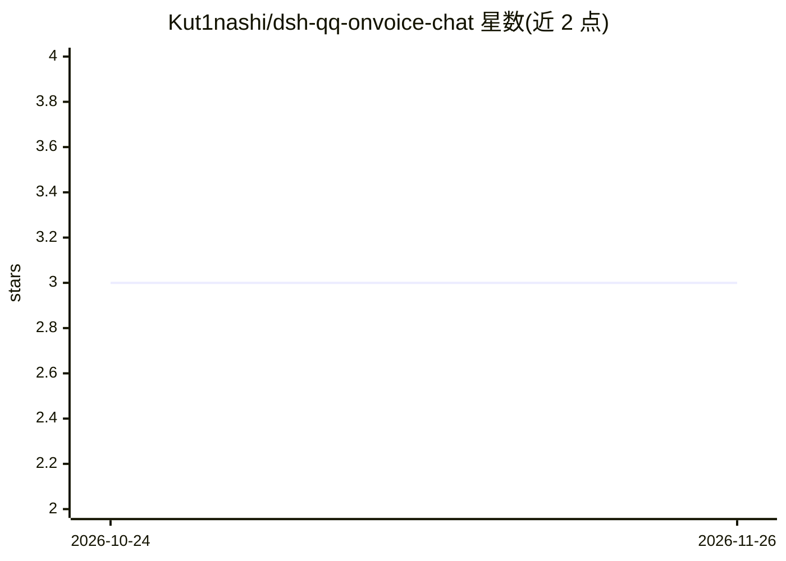

# Kut1nashi/dsh-qq-onvoice-chat

⭐ 3 · JavaScript · MIT · 推送 2026-10-25 · [GitHub](https://github.com/Kut1nashi/dsh-qq-onvoice-chat) · 个人维护 · 中文 README

**给 QQ 自动聊天 agent 加语音进出与聊天人格的套件**

从 qq-bridge-main 整理出的独立包，为跑在 DeepSeek Harness 上的 QQ 自动聊天 agent 提供三条链路：本地 GPT-SoVITS 零样本克隆合成语音或从语音库发送现成音频（出站）、本地 sherpa-onnx SenseVoice 语音转文本并带 QQ 侧 ASR 与占位符三级降级（入站）、DSH agent preset 形式的人格提示词与工具白名单。GPT-SoVITS 整合包、SenseVoice 模型等刻意不含在仓库内，默认按 Windows 路径配置，未做跨平台端到端实测。

## 筛选速览

| 维度 | 判定 | 备注 |
|---|---|---|
| AI 角色 | `ai-native` | 本体是模型或模型工具 |
| 许可风险 | `permissive` | MIT |
| 部署形态 | `desktop` | 安装包/桌面程序 |
| 模型依赖 | — | README 未给出锁定关系 |
| 硬件要求 | — | 无带数字的原话,不猜 |
| 安装摩擦 | `medium` | 含编译或系统依赖之一 |
| 成熟度 | — | 结构信号不足 |

## 能力要点

- 本地 GPT-SoVITS 零样本音色克隆与语音库发送两条出站出口
- 本地 SenseVoice STT，三级降级任何一级失败不打断聊天
- 路径白名单、语音独立限流、发送回读确认等安全边界
- 插件以 npm link 方式装入 DSH profile，版本对应 DSH 0.1.7

## 适用场景

- 让 QQ 自动聊天机器人能发送自己音色的语音
- 让机器人听懂收到的 QQ 语音并转成文本处理
- 给聊天 agent 配置一套带工具边界的拟人人格

## 场景标签

`聊天机器人` `语音合成` `语音识别` · 领域:对话与助手

## 证据(README 行号)

> L3: DeepSeek Harness 上跑 **QQ 自动聊天**时，让 AI **会说话（TTS）**、
> L17: |**AI 开口说话**|出站|本地 GPT-SoVITS 零样本克隆，或从语音库挑现成音频|`packages/voice-out/`|
> L18: |**AI 听懂语音**|入站|本地 sherpa-onnx SenseVoice（SILK → 16k wav → 文本），QQ 侧 ASR 兜底|`packages/voice-in/`|

## 星数曲线

2026-10-24 3 → 2026-11-26 3（+0）

---
*卡片 v1 · prompt 1.4 · 生成 2026-11-22 · 置信度 high · 依据 README sha `b6328a2caffc` · [字段定义](../../DATASET.md)*
