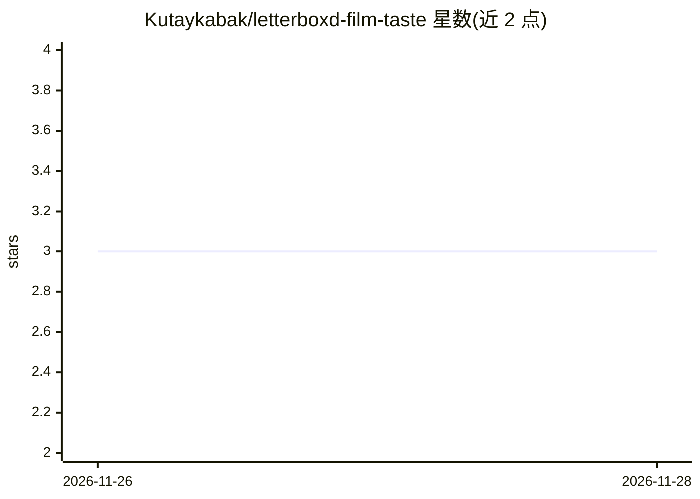

# Kutaykabak/letterboxd-film-taste

⭐ 3 · Jupyter Notebook · MIT · 推送 2026-11-24 · [GitHub](https://github.com/Kutaykabak/letterboxd-film-taste) · [官网](https://kutaykabak.github.io/letterboxd-film-taste/) · 个人维护 · 中文 README

**基于个人 Letterboxd 评分的数据科学与评分预测分析项目**

作者将自己 355 部已评分影片与 TMDB API 元数据合并，用非参数检验（Kruskal-Wallis、Mann-Whitney、Spearman）分析类型/年代/语言偏好，并用重复与嵌套交叉验证比较 Random Forest、XGBoost、LightGBM、有序逻辑回归等模型的个人评分预测（RMSE 约 0.66）。数据规模小是作者声明的限制；原始个人导出数据不入库。结果通过交互式单页、Streamlit 仪表盘和 Power BI 报告三种形式呈现，部署在 GitHub Pages。

## 筛选速览

| 维度 | 判定 | 备注 |
|---|---|---|
| AI 角色 | `ai-native` | 本体是模型或模型工具 |
| 许可风险 | `permissive` | MIT |
| 部署形态 | `library` | 以包/库形式分发 |
| 模型依赖 | — | README 未给出锁定关系 |
| 硬件要求 | — | 无带数字的原话,不猜 |
| 安装摩擦 | `low` | 无编译、无系统依赖或容器化 |
| 成熟度 | — | 结构信号不足 |

## 能力要点

- 重复 10 次 5 折交叉验证与嵌套交叉验证的模型比较
- Benjamini-Hochberg/Holm 多重比较校正
- 对 5000 部 TMDB 高票影片输出个人评分预测
- 交互式单页 + Streamlit 仪表盘 + Power BI 三种展示形式

## 适用场景

- 分析自己的 Letterboxd 评分偏好与变化趋势
- 为个人待看片单生成模型预测排序
- 学习小样本数据的交叉验证与多重比较实践

## 场景标签

`数据分析` · 领域:效率与自动化

## 证据(README 行号)

> L9: A data science and machine learning project built on my own Letterboxd data. I joined the 355 films I have rated wit
> L12: 2. Can I predict the rating I would give a film I haven't seen yet?
> L67: - Evaluation: 5-fold cross-validation repeated 10 times (50 splits). Every model sees the same splits.

## 星数曲线

2026-11-26 3 → 2026-11-28 3（+0）

---
*卡片 v1 · prompt 1.4 · 生成 2026-11-26 · 置信度 mid · 依据 README sha `f77da8a89603` · [字段定义](../../DATASET.md)*
