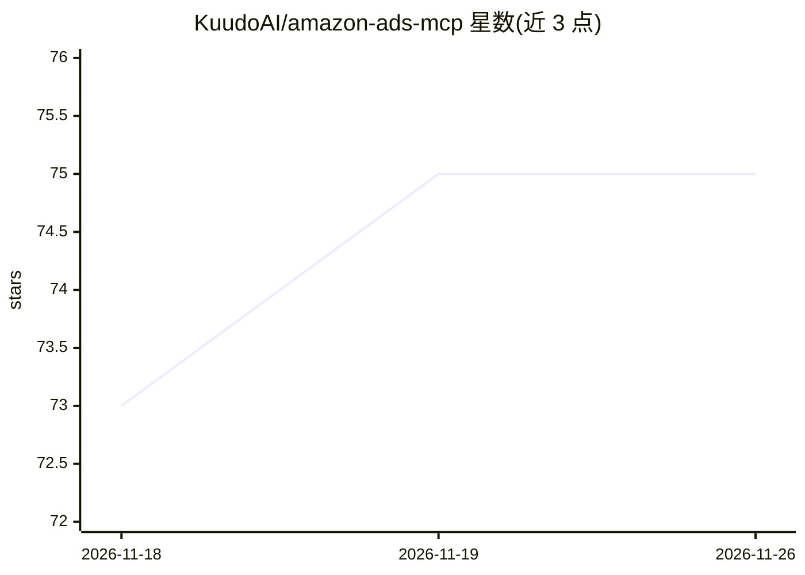

# KuudoAI/amazon-ads-mcp

⭐ 75 · Python · MIT · 推送 2026-11-06 · [GitHub](https://github.com/KuudoAI/amazon-ads-mcp) · [官网](https://www.kuudo.com/features/amazon-ads-mcp/) · 组织维护

**开源 Amazon Ads MCP 服务器：让 AI 客户端调用广告 API**

面向 Claude、ChatGPT、Cursor 等 MCP 客户端的 Model Context Protocol 服务器，覆盖 Amazon Ads API 的 711 个操作、53 个服务，含 Sponsored Products/Brands/Display/TV、Amazon DSP 与 Amazon Marketing Cloud，提供读与写工具。支持 NA/EU/FE 多区域自动路由，错误响应设计为可指导模型下次调用的纠正提示。MIT 许可，可用 Docker 或 Python 3.10+ 自行运行，也可由 Kuudo 部署到用户自有云账户；属于 Kuudo Amazon agent 平台的工具层。

## 筛选速览

| 维度 | 判定 | 备注 |
|---|---|---|
| AI 角色 | `ai-ecosystem` | LLM/agent 周边工具 |
| 许可风险 | `permissive` | MIT |
| 部署形态 | `self-host` | docker 或自建部署 |
| 模型依赖 | locked-api |  |
| 硬件要求 | — | 无带数字的原话,不猜 |
| 安装摩擦 | `low` | 无编译、无系统依赖或容器化 |
| 成熟度 | — | 结构信号不足 |

## 能力要点

- 覆盖 Amazon Ads API 711 个操作、53 个服务，含读与写工具
- 完整 MCP 协议兼容，可接入 Claude/ChatGPT/Cursor 等客户端
- NA/EU/FE 多区域端点自动路由
- Docker 或 Python 3.10+ 自托管运行，MIT 许可

## 适用场景

- 在 Claude/ChatGPT 中直接创建、更新和分析 Amazon 广告活动
- 构建管理 Amazon Ads 的营销聊天机器人或自动化平台
- 代理机构跨多客户账户管理广告投放

## 场景标签

 · 领域:电商广告/开发工具

## 证据(README 行号)

> L13: > **Kuudo's Amazon Ads MCP server gives Claude, ChatGPT, Cursor and any MCP client 711 Amazon Ads API operations ac
> L54: ## What Are MCP Tools?

## 星数曲线

2026-11-18 73 → 2026-11-26 75（+2）

---
*卡片 v1 · prompt 1.4 · 生成 2026-11-18 · 置信度 high · 依据 README sha `f20d63521f70` · [字段定义](../../DATASET.md)*
