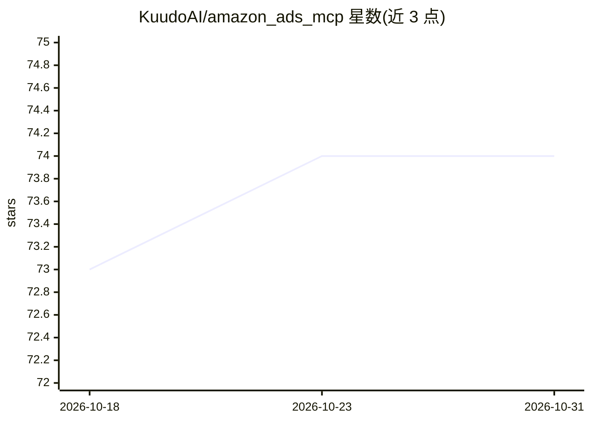

# KuudoAI/amazon_ads_mcp

⭐ 74 · Python · MIT · 推送 2026-10-14 · [GitHub](https://github.com/KuudoAI/amazon_ads_mcp) · [官网](https://www.kuudo.com/) · 组织维护

**面向 Amazon 广告 API 的 MCP 服务器：让 AI agent 安全调用广告接口**

由 Openbridge 制作的 Model Context Protocol 服务器，把 Amazon Ads API 的操作封装为 MCP 工具，供 Claude Desktop、ChatGPT、Cursor 等 MCP 客户端调用。覆盖 Sponsored Products/Brands/Display、DSP、AMC、报表、Ads API v1（Beta）等接口，支持 NA/EU/FE 多区域自动路由。其机制特点是把错误响应做成带纠正提示的学习面：校验器、别名表与弃用形态表帮助 agent 减少重试往返。推荐 Docker Compose 从源码构建运行，需自备 Amazon Ads API 访问凭证。它是 Kuudo Amazon agent 平台的工具层。

## 筛选速览

| 维度 | 判定 | 备注 |
|---|---|---|
| AI 角色 | `ai-ecosystem` | LLM/agent 周边工具 |
| 许可风险 | `permissive` | MIT |
| 部署形态 | `self-host` | docker 或自建部署 |
| 模型依赖 | locked-api |  |
| 硬件要求 | — | 无带数字的原话,不猜 |
| 安装摩擦 | `low` | 无编译、无系统依赖或容器化 |
| 成熟度 | — | 结构信号不足 |

## 能力要点

- 将 Amazon Ads API 操作封装为 MCP 工具，覆盖 Sponsored Products/Brands/Display、DSP、AMC、Ads API v1 等
- NA/EU/FE 多区域端点自动路由
- 错误响应携带纠正提示，内置校验器、别名表与弃用形态表
- 支持通过 AMAZON_AD_API_PACKAGES 环境变量按包启用 API 面

## 适用场景

- 在 Claude Desktop 等客户端中创建、分析广告活动与生成报表
- 构建管理 Amazon 广告的营销聊天机器人或自动化平台
- 代理机构进行多客户、多账户的广告管理集成

## 场景标签

 · 领域:电商广告/AI 工具接入

## 证据(README 行号)

> L3: **Build AI-powered advertising applications with the Model Context Protocol (MCP) SDK for Amazon Advertising API**
> L28: ## What Are MCP Tools?
> L33: * The AI can request campaign reports, budgets, or targeting data safely.

## 星数曲线

2026-10-18 73 → 2026-10-31 74（+1）

---
*卡片 v1 · prompt 1.4 · 生成 2026-10-24 · 置信度 high · 依据 README sha `d40a57be5185` · [字段定义](../../DATASET.md)*
