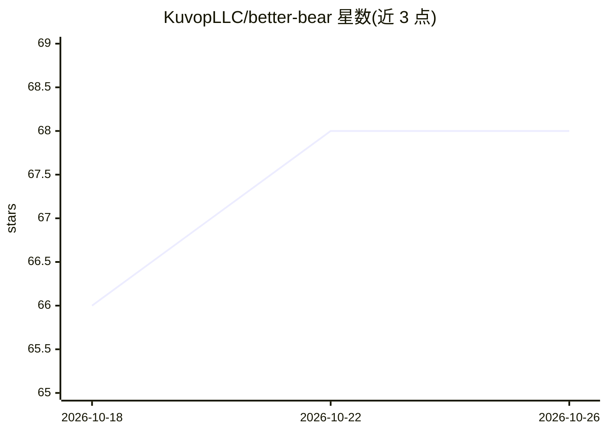

# KuvopLLC/better-bear

⭐ 68 · Swift · MIT · 推送 2026-04-23 · [GitHub](https://github.com/KuvopLLC/better-bear) · [官网](https://better-bear.com/) · 组织维护

**为 Claude 接入 Bear 笔记的 MCP 服务器与 CLI**

通过 CloudKit 访问 Bear 笔记的 MCP 服务器与命令行工具：安装 bcli 二进制并认证 iCloud 后，可将 MCP server 注册到 Claude Desktop（.mcpb bundle）与 Claude Code。提供 34 个 MCP 工具，覆盖笔记、标签、TODO、附件、全文搜索与统计等操作。附 context library 功能：用 #context 标签筛选笔记，同步为面向 LLM 的精简文件夹，Claude 先读 index.md 再按需加载文件，架构遵循 Karpathy 三文件夹模式（bear/external/inbox）。仅限 macOS/iCloud 生态。

## 筛选速览

| 维度 | 判定 | 备注 |
|---|---|---|
| AI 角色 | `ai-ecosystem` | LLM/agent 周边工具 |
| 许可风险 | `permissive` | MIT |
| 部署形态 | `library` | 以包/库形式分发 |
| 模型依赖 | — | README 未给出锁定关系 |
| 硬件要求 | — | 无带数字的原话,不猜 |
| 安装摩擦 | `low` | 无编译、无系统依赖或容器化 |
| 成熟度 | — | 结构信号不足 |

## 能力要点

- 34 个 MCP 工具覆盖笔记、标签、TODO、附件、搜索、统计等
- context library：#context 标签同步为 LLM 优化的文件夹，index-first 检索
- 一条安装脚本完成 bcli 安装、iCloud 认证与 Claude Desktop/Code 注册
- 所有 MCP 命令均可独立在终端作为 CLI 使用

## 适用场景

- 让 Claude Desktop 或 Claude Code 直接读写我的 Bear 笔记
- 把部分 Bear 笔记整理成 Claude 可按需检索的知识库
- 在终端快速搜索、创建、管理 Bear 笔记

## 场景标签

`知识库管理` · 领域:知识与检索

## 证据(README 行号)

> L3: better-bear MCP server
> L12: MCP server and CLI for Bear notes via CloudKit. Includes a **context library** — a curated, synced folder of notes 
> L77: 34 tools covering notes, tags, TODOs, attachments, search, front matter, stats, health checks, and the context libr

## 星数曲线

2026-10-18 66 → 2026-10-26 68（+2）

---
*卡片 v1 · prompt 1.4 · 生成 2026-10-24 · 置信度 high · 依据 README sha `fd9a94427303` · [字段定义](../../DATASET.md)*
