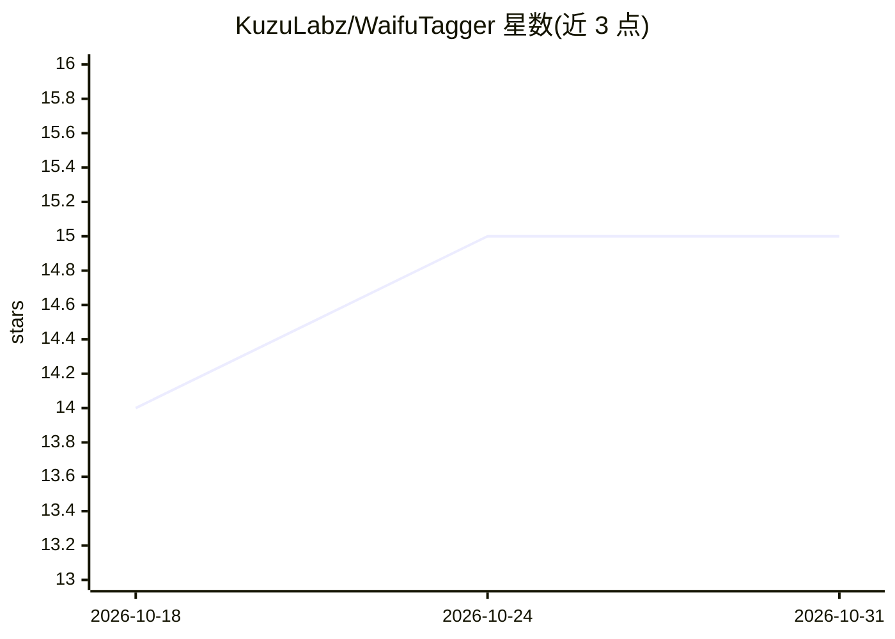

# KuzuLabz/WaifuTagger

⭐ 15 · TypeScript · 推送 2026-10-01 · [GitHub](https://github.com/KuzuLabz/WaifuTagger) · 个人维护 · 中文 README

**离线给图片打 danbooru 标签的 Android/桌面应用**

基于 React Native 与 ONNX Runtime 的图像打标应用，在移动端与桌面端本地运行动漫图像分类模型，为任意图片（动漫、漫画、真实照片）输出 booru 风格标签，并可识别图中角色。内置模型管理器，提供 WD Convnext/Swinv2 Tagger v3 与 Camie Tagger v2 等模型（QUINT8/FP16 量化），支持 NSFW 分级检测与输出格式自定义，提供 7 种界面语言，通过 GitHub Releases 与 itch.io 分发安装包，模型全部离线推理。

## 筛选速览

| 维度 | 判定 | 备注 |
|---|---|---|
| AI 角色 | `ai-native` | 本体是模型或模型工具 |
| 许可风险 | `none` | — |
| 部署形态 | `None` |  |
| 模型依赖 | — | README 未给出锁定关系 |
| 硬件要求 | — | 无带数字的原话,不猜 |
| 安装摩擦 | `low` | 无编译、无系统依赖或容器化 |
| 成熟度 | — | 结构信号不足 |

## 能力要点

- 本地 ONNX 推理，完全离线打标
- 支持多个动漫 tagger 模型（QUINT8/FP16 量化）
- 识别图中动漫角色与 NSFW 分级（explicit/questionable/sensitive/safe）
- 覆盖 Android 与桌面端，7 种界面语言

## 适用场景

- 给动漫图片自动生成 booru 标签用于整理或提示词
- 识别图片中出现的动漫角色
- 本地离线批量检查图片的 NSFW 分级

## 场景标签

`目标检测` · 领域:感知与多模态

## 证据(README 行号)

> L14: Run anime image classification models on mobile and desktop!
> L25: - 🏷️ Tag any image (anime, manga, real photos) with booru tags

## 星数曲线

2026-10-18 14 → 2026-10-31 15（+1）

---
*卡片 v1 · prompt 1.4 · 生成 2026-10-30 · 置信度 high · 依据 README sha `65cc9324c66d` · [字段定义](../../DATASET.md)*
