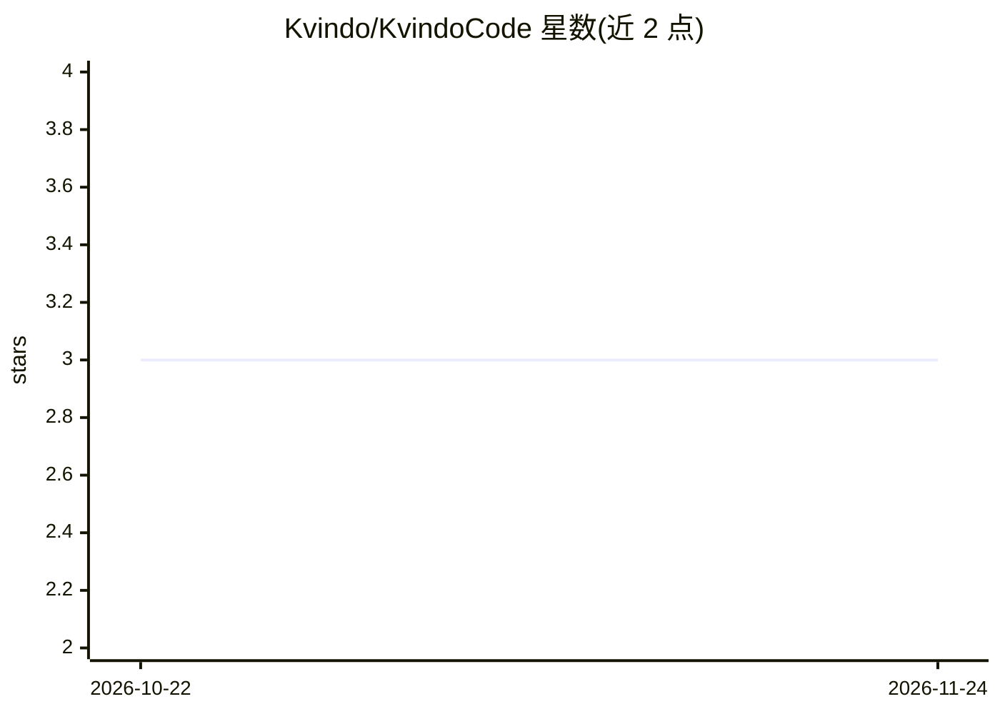

# Kvindo/KvindoCode

⭐ 3 · C# · 推送 2026-10-19 · [GitHub](https://github.com/Kvindo/KvindoCode) · 个人维护

**跨平台桌面 AI 编码代理，含 git worktree 隔离与密钥保险库**

基于 Avalonia/.NET 的桌面 AI 编码代理，运行完整 agent 循环（文件、shell、git worktree、浏览器、后台任务、子代理），对接任意兼容 /v1/chat/completions 的端点。每个会话使用独立 git worktree 与分支实现隔离；内置 AES-256-GCM 加密密钥保险库，对工具输出与出站请求中的凭据进行检测、掩码与可选轮换。支持计划评审门、XTerm 终端网格、会话搜索、token/成本统计，提供 install.sh 源码安装与预编译发布包两种途径。

## 筛选速览

| 维度 | 判定 | 备注 |
|---|---|---|
| AI 角色 | `ai-native` | 本体是模型或模型工具 |
| 许可风险 | `none` | — |
| 部署形态 | `None` |  |
| 模型依赖 | — | README 未给出锁定关系 |
| 硬件要求 | — | 无带数字的原话,不猜 |
| 安装摩擦 | `medium` | 含编译或系统依赖之一 |
| 成熟度 | — | 结构信号不足 |

## 能力要点

- 每会话独立 git worktree/分支，文件工具拒绝越界写入
- AES-256-GCM 加密密钥保险库：凭据检测、掩码、泄露登记与密钥轮换
- 计划模式带对抗式评审门（多轮修订、每轮时限）
- XTerm 四窗格终端、后台任务、Chrome DevTools 浏览器控制与 Telegram 工具

## 适用场景

- 在桌面 GUI 中以 agent 方式修改本地代码库
- 并行运行多个编码会话而不互相污染工作区
- 阻止 .env/数据库凭据进入模型上下文与请求

## 场景标签

`编码 Agent` · 领域:编码与开发

## 证据(README 行号)

> L3: **A desktop AI coding agent for Linux, Windows and macOS - a native Avalonia app, not a terminal TUI.** It runs a
> L17: **At a glance** - `git worktree` per session; plan mode with an adversarial plan reviewer; subagents with
> L60: |**Projects / sessions**|One folder = one project. With `claudeSessionsDir` set (Settings → Sessions) KvindoCode **

## 星数曲线

2026-10-22 3 → 2026-11-24 3（+0）

---
*卡片 v1 · prompt 1.4 · 生成 2026-11-22 · 置信度 high · 依据 README sha `3fecb5837231` · [字段定义](../../DATASET.md)*
