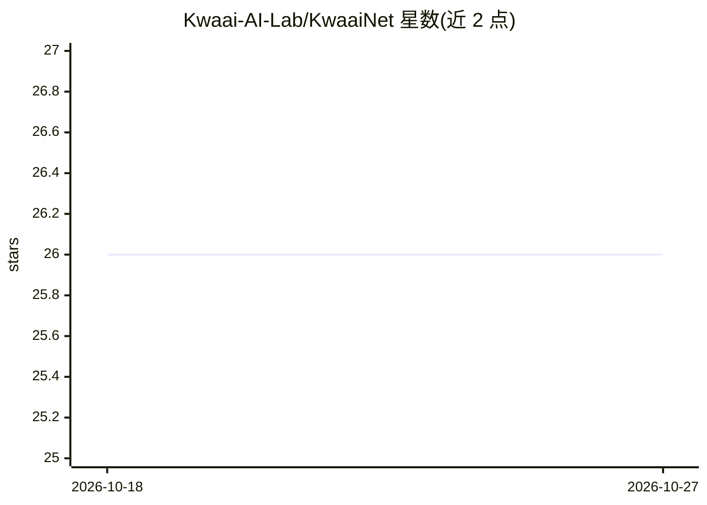

# Kwaai-AI-Lab/KwaaiNet

⭐ 26 · Rust · MIT · 推送 2026-10-26 · [GitHub](https://github.com/Kwaai-AI-Lab/KwaaiNet) · [官网](https://www.kwaai.ai/) · 组织维护

**面向开发者与研究者的去中心化 AI 节点架构（Layer 8 信任与智能层）**

由 Kwaai 基金会（501(c)(3) 非营利）构建的去中心化 AI 节点架构：每个节点包含加密身份与可验证凭证的去中心化信任图、跨异构 CPU/GPU 的 Petals 式模型分片共享算力、通过 Ollama 贡献整模型推理、VPU 式多租户知识存储（VPK，存储节点只持有不透明向量）、本地优先 RAG 与知识图谱，以及基于意图的 P2P 路由。对外提供 OpenAI 兼容的 chat-completion HTTP API。以 Rust CLI 形式分发，提供 shell/PowerShell/Homebrew/Nix/cargo 安装方式。当前版本 v0.6.8（< v1.0 预发布阶段），Apple Silicon 上分片路径 Metal 解码慢于 CPU，仅通过 Ollama 贡献整模型。

## 筛选速览

| 维度 | 判定 | 备注 |
|---|---|---|
| AI 角色 | `ai-ecosystem` | LLM/agent 周边工具 |
| 许可风险 | `permissive` | MIT |
| 部署形态 | `library` | 以包/库形式分发 |
| 模型依赖 | local-ok | 支持本地模型 |
| 硬件要求 | `cpu-ok` | |
| 安装摩擦 | `medium` | 含编译或系统依赖之一 |
| 成熟度 | `idea` | |

## 能力要点

- Petals 式模型分片在多台机器间共享单一超大模型（CPU 与 CUDA）
- 节点通过 /kwaai/ollama-proxy/1.0.0 协议以 Ollama 贡献整模型推理
- VPK 多租户知识存储：存储节点只持有不透明向量，不接收文档
- Ed25519 身份、W3C 可验证凭证与本地时间衰减信任分，无中心信任注册表

## 适用场景

- 运行自有节点并通过 OpenAI 兼容 API 发起 chat-completion 请求
- 将本机 CPU/GPU 算力贡献给网络做分片或整模型推理
- 社区自持、自治理地运行智能 agent 基础设施

## 场景标签

`推理引擎` · 领域:训练与推理

## 证据(README 行号)

> L9: - **Shared LLM compute** over heterogeneous CPUs/GPUs. Petals-style **block sharding** pools a single oversized mode
> L31: `/kwaai/ollama-proxy/1.0.0` protocol on every platform, so installing Ollama and pulling a model
> L249: curl http://localhost:11435/v1/chat/completions \
> L76: This quickstart shows how to install the native Rust CLI, start a node, and send a simple chat-completion request a

## 星数曲线

2026-10-18 26 → 2026-10-27 26（+0）

---
*卡片 v1 · prompt 1.4 · 生成 2026-10-26 · 置信度 high · 依据 README sha `5889ecbef70b` · [字段定义](../../DATASET.md)*
