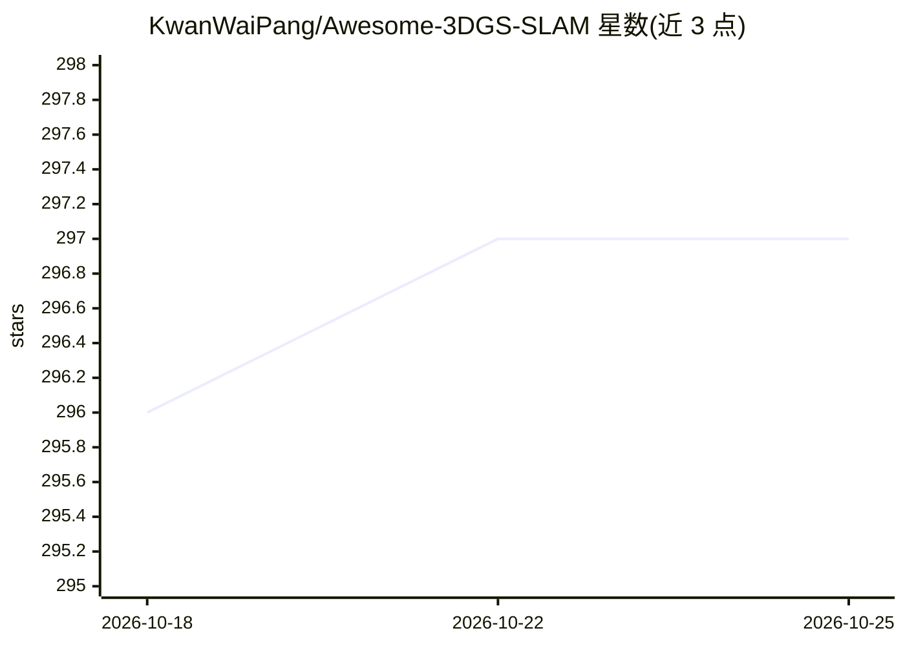

# KwanWaiPang/Awesome-3DGS-SLAM

⭐ 297 · 推送 2026-02-18 · [GitHub](https://github.com/KwanWaiPang/Awesome-3DGS-SLAM) · [官网](https://kwanwaipang.github.io/3DGS-SLAM/) · 个人维护 · 中文 README

**3DGS SLAM 论文与资源策展清单（图像/事件/激光雷达）**

由个人维护的 3D 高斯泼溅 SLAM 论文清单：按 Image-based、LiDAR-based、Event-based 三类组织，以表格收录 2024–2026 年发表于 CVPR、ECCV、ICRA、TRO、RAL、arXiv 等处的论文，条目含年份、发表venue、标题与代码仓库链接，部分条目附中文备注说明方法要点（如 VLM 特征嵌入、NeRF+3DGS 混合表征、多机融合建图）。接受通过 PR 和 issue 补充新论文。仅提供条目索引，不含可运行代码或安装方式。

## 筛选速览

| 维度 | 判定 | 备注 |
|---|---|---|
| AI 角色 | `ai-knowledge` | 知识聚合/清单类 |
| 许可风险 | `none` | — |
| 部署形态 | `None` |  |
| 模型依赖 | — | README 未给出锁定关系 |
| 硬件要求 | — | 无带数字的原话,不猜 |
| 安装摩擦 | `medium` | 含编译或系统依赖之一 |
| 成熟度 | — | 结构信号不足 |

## 能力要点

- 按 Image/LiDAR/Event 三类传感器模态组织条目
- 条目含发表 venue、年份、代码仓库链接与中文方法备注
- 覆盖 2024–2026 年百余篇 3DGS SLAM 论文

## 适用场景

- 查找 3DGS SLAM 方向的最新论文与开源实现
- 按传感器模态调研 SLAM 方案选型
- 跟踪动态场景、语义、多机等细分主题的进展

## 场景标签

`精选清单` · 领域:学习与行业

## 证据(README 行号)

> L3: This repository contains a curated list of resources addressing the 3DGS (3D Gaussian Splatting) SLAM, includinig im
> L14: - Image-based 3DGS

## 星数曲线

2026-10-18 296 → 2026-10-25 297（+1）

---
*卡片 v1 · prompt 1.4 · 生成 2026-10-21 · 置信度 high · 依据 README sha `19fd08fa61a1` · [字段定义](../../DATASET.md)*
