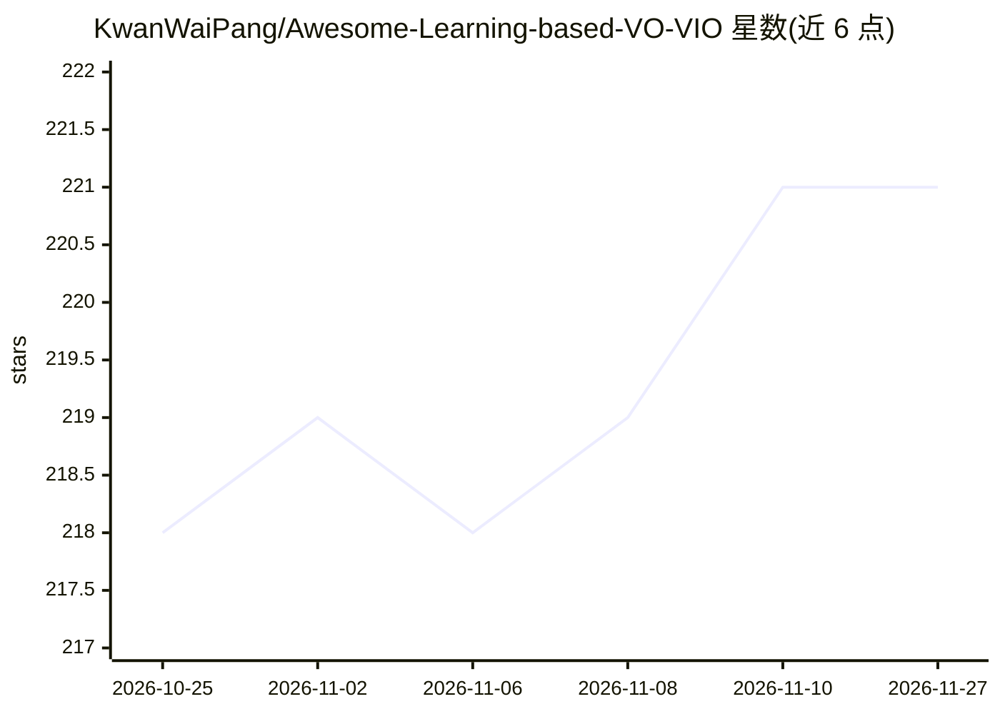

# KwanWaiPang/Awesome-Learning-based-VO-VIO

⭐ 221 · 推送 2026-11-01 · [GitHub](https://github.com/KwanWaiPang/Awesome-Learning-based-VO-VIO) · [官网](https://kwanwaipang.github.io/Learning-based-VO-VIO/) · 个人维护 · 中文 README

**面向 SLAM 研究者的学习型里程计论文清单**

按年份与会议组织的学习型里程计论文聚合清单，覆盖视觉里程计、视觉惯性里程计、惯性里程计、LiDAR 里程计、Semantic SLAM、NeRF SLAM 等方向，条目含论文标题、发表 venue、代码仓库与中文笔记链接，并欢迎通过 PR/issue 补充论文。仅做资源整理与链接索引，不含可安装运行的软件本体。

## 筛选速览

| 维度 | 判定 | 备注 |
|---|---|---|
| AI 角色 | `ai-knowledge` | 知识聚合/清单类 |
| 许可风险 | `none` | — |
| 部署形态 | `None` |  |
| 模型依赖 | — | README 未给出锁定关系 |
| 硬件要求 | — | 无带数字的原话,不猜 |
| 安装摩擦 | `low` | 无编译、无系统依赖或容器化 |
| 成熟度 | — | 结构信号不足 |

## 能力要点

- 覆盖 VO/VIO/IO/LiDAR/Semantic SLAM/NeRF SLAM 等多类学习型里程计论文
- 条目按年份与 venue 组织，附代码仓库与笔记链接
- 支持社区通过 pull request 与 issue 补充条目

## 适用场景

- 查找学习型视觉/惯性里程计的相关论文与开源实现
- 调研 SLAM 方向的学习型方法脉络
- 补充或维护领域论文清单

## 场景标签

`精选清单` `科研工具` · 领域:学习与行业

## 证据(README 行号)

> L1: Awesome Learning-based Odometry
> L3: This repository contains a curated list of resources addressing Learning-based visual odometry (including both image
> L17: ## Learning-based VO

## 星数曲线

2026-10-25 218 → 2026-11-27 221（+3）

---
*卡片 v1 · prompt 1.4 · 生成 2026-11-26 · 置信度 high · 依据 README sha `806da5b0e052` · [字段定义](../../DATASET.md)*
