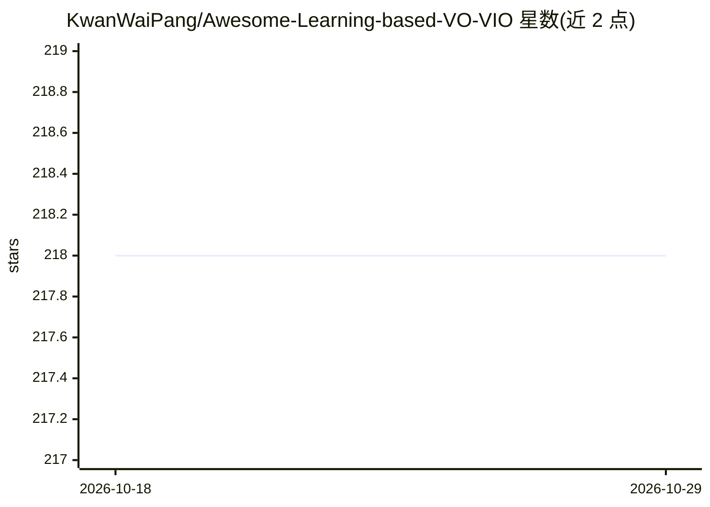

# KwanWaiPang/Awesome-Learning-based-VO-VIO

⭐ 218 · 推送 2026-09-30 · [GitHub](https://github.com/KwanWaiPang/Awesome-Learning-based-VO-VIO) · [官网](https://kwanwaipang.github.io/Learning-based-VO-VIO/) · 个人维护 · 中文 README

**基于学习的视觉/惯性里程计论文清单（VO/VIO/SLAM）**

个人维护的 awesome 类论文综述仓库：按 Learning-based VO、VIO、惯性里程计等类别，以表格形式收录 2015-2026 年间发表于 CVPR、ICRA、TRO、RAL 等会议与期刊的论文，条目含年份、发表场所、论文标题、代码仓库链接与中文笔记（如 DROID-SLAM、MegaSaM、DEIO 等），部分条目附方法细节说明。面向 SLAM/机器人定位方向的研究者，通过 PR 与 issue 接收补充。

## 筛选速览

| 维度 | 判定 | 备注 |
|---|---|---|
| AI 角色 | `ai-knowledge` | 知识聚合/清单类 |
| 许可风险 | `none` | — |
| 部署形态 | `None` |  |
| 模型依赖 | — | README 未给出锁定关系 |
| 硬件要求 | — | 无带数字的原话,不猜 |
| 安装摩擦 | `low` | 无编译、无系统依赖或容器化 |
| 成熟度 | — | 结构信号不足 |

## 能力要点

- 按 VO/VIO/惯性里程计等类别组织的论文表格（年份+会议+标题+代码链接）
- 覆盖 2015-2026 年 CVPR/ICRA/TRO/RAL 等场所的论文
- 多条目附中文方法笔记
- 通过 PR/issue 接收社区补充

## 适用场景

- 查找学习类视觉里程计/SLAM 论文及对应开源代码
- 调研 event camera、NeRF SLAM、语义 SLAM 等子方向文献
- 为科研选题梳理 VO/VIO 领域发展脉络

## 场景标签

`精选清单` `科研工具` · 领域:学习与行业

## 证据(README 行号)

> L1: Awesome Learning-based Odometry
> L3: This repository contains a curated list of resources addressing Learning-based visual odometry (including both image

## 星数曲线

2026-10-18 218 → 2026-10-29 218（+0）

---
*卡片 v1 · prompt 1.4 · 生成 2026-10-22 · 置信度 high · 依据 README sha `4691fba25f22` · [字段定义](../../DATASET.md)*
