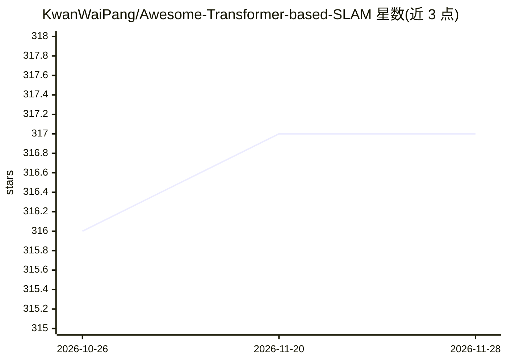

# KwanWaiPang/Awesome-Transformer-based-SLAM

⭐ 317 · 推送 2026-11-02 · [GitHub](https://github.com/KwanWaiPang/Awesome-Transformer-based-SLAM) · [官网](https://kwanwaipang.github.io/Transformer_SLAM/) · 个人维护 · 中文 README

**面向 SLAM 研究者的 Transformer 类论文策展清单**

收录运用 Transformer 解决 SLAM 相关任务的论文资源清单，按全量 SLAM（位姿与深度）、位姿跟踪等主题分表组织，每条含年份、发表 venue、论文标题、代码仓库链接与中文注记，覆盖光流、特征匹配、立体匹配、深度估计、三维重建、位姿估计、视觉/视觉惯性里程计等方向。欢迎以 pull request 或 issue 方式补充遗漏论文。清单本身不包含安装或运行步骤，仅为文献导航。

## 筛选速览

| 维度 | 判定 | 备注 |
|---|---|---|
| AI 角色 | `ai-knowledge` | 知识聚合/清单类 |
| 许可风险 | `none` | — |
| 部署形态 | `None` |  |
| 模型依赖 | — | README 未给出锁定关系 |
| 硬件要求 | — | 无带数字的原话,不猜 |
| 安装摩擦 | `low` | 无编译、无系统依赖或容器化 |
| 成熟度 | — | 结构信号不足 |

## 能力要点

- 按 Transformer-based SLAM 与 Pose Tracking 等主题分表组织论文条目
- 每条论文标注年份、venue、仓库链接与注记
- 接受 PR 与 issue 补充收录

## 适用场景

- 调研 Transformer 在 SLAM 中的最新论文进展
- 查找某篇 SLAM 论文的开源代码仓库
- 跟踪前馈 3D 重建（如 VGGT 系）在 SLAM 中的应用

## 场景标签

`精选清单` · 领域:学习与行业

## 证据(README 行号)

> L1: Awesome Transformer-based SLAM
> L3: This repository contains a curated list of resources addressing SLAM-related tasks employing Transformer, including 
> L21: |Year|Venue|Paper Title|Repository|Note|

## 星数曲线

2026-10-26 316 → 2026-11-28 317（+1）

---
*卡片 v1 · prompt 1.4 · 生成 2026-11-25 · 置信度 high · 依据 README sha `213592fa1d48` · [字段定义](../../DATASET.md)*
