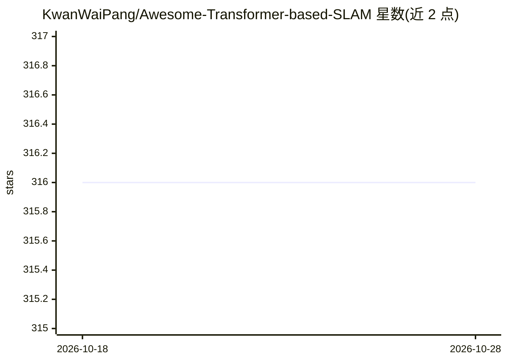

# KwanWaiPang/Awesome-Transformer-based-SLAM

⭐ 316 · 推送 2026-10-13 · [GitHub](https://github.com/KwanWaiPang/Awesome-Transformer-based-SLAM) · [官网](https://kwanwaipang.github.io/Transformer_SLAM/) · 个人维护 · 中文 README

**Transformer-based SLAM 论文清单：覆盖位姿估计、深度估计与重建**

由个人维护的 awesome 类论文综述仓库，按表格形式编目采用 Transformer 的 SLAM 相关工作，分为完整 SLAM（位姿与深度）与位姿跟踪两大类，条目含年份、发表会议、论文标题、代码仓库链接与中文摘要笔记，主题覆盖光流、立体重建匹配、深度估计、3D 重建、回环与视觉里程计等。面向 SLAM/三维视觉方向的研究者检索文献，通过 PR/issue 接受补充，无安装或运行内容。

## 筛选速览

| 维度 | 判定 | 备注 |
|---|---|---|
| AI 角色 | `ai-knowledge` | 知识聚合/清单类 |
| 许可风险 | `none` | — |
| 部署形态 | `None` |  |
| 模型依赖 | — | README 未给出锁定关系 |
| 硬件要求 | — | 无带数字的原话,不猜 |
| 安装摩擦 | `low` | 无编译、无系统依赖或容器化 |
| 成熟度 | — | 结构信号不足 |

## 能力要点

- 两大类表格编目：完整 SLAM 与位姿跟踪/状态估计
- 每条含年份、venue、代码仓库链接与中文方法摘要
- 覆盖 2023–2026 年会议与 arXiv 论文（CVPR/ECCV/RAL/TRO 等）
- 通过 PR/issue 接受社区补充

## 适用场景

- 查找基于 Transformer 的 SLAM 与视觉里程计论文
- 顺论文条目找到对应开源代码仓库
- 了解前馈几何模型（VGGT/MASt3R 系）在 SLAM 中的用法脉络

## 场景标签

`精选清单` `科研工具` · 领域:学习与行业

## 证据(README 行号)

> L3: This repository contains a curated list of resources addressing SLAM-related tasks employing Transformer, including 
> L17: ## Transformer-based SLAM

## 星数曲线

2026-10-18 316 → 2026-10-28 316（+0）

---
*卡片 v1 · prompt 1.4 · 生成 2026-10-21 · 置信度 high · 依据 README sha `7bbb8e0e7a4d` · [字段定义](../../DATASET.md)*
