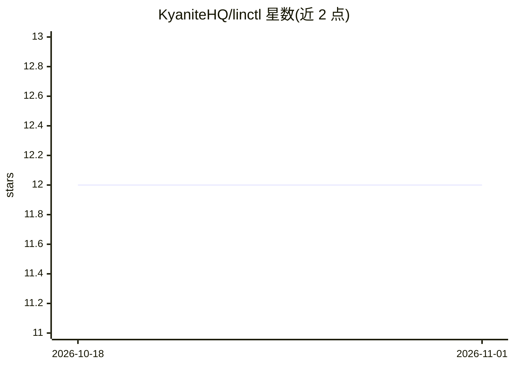

# KyaniteHQ/linctl

⭐ 12 · Go · MIT · 推送 2026-10-31 · [GitHub](https://github.com/KyaniteHQ/linctl) · [官网](https://github.com/KyaniteHQ/linctl) · 组织维护

**给 AI agent 用的 Linear CLI：写入仅限仓库内钉定的团队**

用 Go 编写的 Linear 命令行工具，供通过 shell 驱动它的 AI agent 使用。读操作覆盖 token 可见的全部范围；每次写操作前对照实时 OAuth 凭证重新解析组织与团队，与仓库中 .linctl.toml 钉定的目标比对，不匹配则以 TARGET_MISMATCH 硬停并无旁路 flag。README 明确列守卫的边界：不防恶意 agent、不做团队内正确性校验、检查与写入是两次 API 调用。与 Linear MCP server 相比不加载工具 schema，按需用 usage 输出约 400 token。

## 筛选速览

| 维度 | 判定 | 备注 |
|---|---|---|
| AI 角色 | `ai-ecosystem` | LLM/agent 周边工具 |
| 许可风险 | `permissive` | MIT |
| 部署形态 | `library` | 以包/库形式分发 |
| 模型依赖 | — | README 未给出锁定关系 |
| 硬件要求 | — | 无带数字的原话,不猜 |
| 安装摩擦 | `low` | 无编译、无系统依赖或容器化 |
| 成熟度 | — | 结构信号不足 |

## 能力要点

- 写入前对照实时凭证解析组织与团队，不匹配即 TARGET_MISMATCH 硬停
- 无可绕过守卫的 bypass flag（ADR 0001 拒绝）
- 60+ 顶层命令覆盖 Linear schema，--json/--id-only 等脚本化输出 flag
- 提供 skills/linctl/SKILL.md 供 agent 学习命令面与输出契约

## 适用场景

- 让 AI agent 在仓库环境中读写 Linear，且写入被限制在钉定团队
- 以较低上下文成本替代 MCP server 接入 Linear
- 用 --fail-on-empty 做 Linear 状态监控脚本

## 场景标签

 · 领域:开发工具/AI agent 基础设施

## 证据(README 行号)

> L8: **A Linear CLI that you can give to an AI agent.**
> L10: Your agent reads Linear as widely as its credential permits. Your agent writes only to the one
> L33: An OAuth token is usually much wider than the task in front of it. linctl makes the token
> L251: An LLM drives linctl from a Bash tool.

## 星数曲线

2026-10-18 12 → 2026-11-01 12（+0）

---
*卡片 v1 · prompt 1.4 · 生成 2026-11-01 · 置信度 high · 依据 README sha `4277a7c6871b` · [字段定义](../../DATASET.md)*
