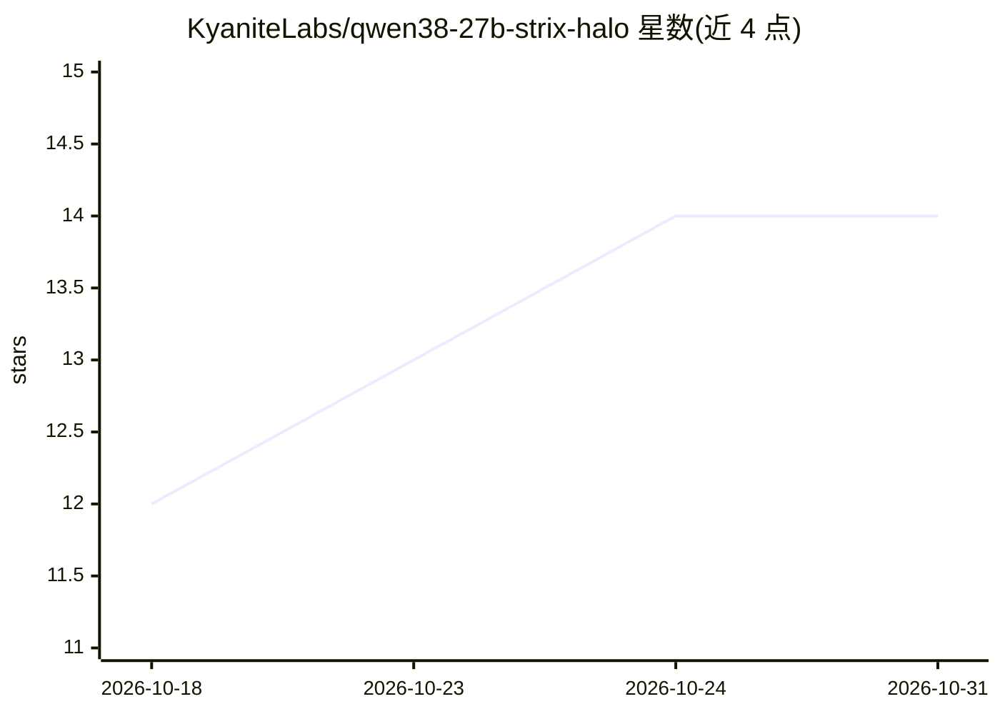

# KyaniteLabs/qwen38-27b-strix-halo

⭐ 14 · Python · MIT · 推送 2026-10-09 · [GitHub](https://github.com/KyaniteLabs/qwen38-27b-strix-halo) · [官网](https://kyanitelabs.tech/blog/qwen-27b-strix-halo-complete) · 组织维护

**在 AMD Strix Halo 上运行 Qwen3.8-27B 的实测调优配置仓库**

面向本地推理运维者的配置与测量档案：给出在 Ryzen AI Max+ 395（Radeon 8060S，统一 LPDDR5X 64GB）上用 llama.cpp 服务 Qwen3.8-27B 的冻结配置（UD-Q4_K_XL 量化、262k 上下文、q4_0 KV cache、MTP+ngram 投机解码），并附完整测量方法：量化梯度对比、needle 检索、GSM8K 配对门控、time-per-task 工具与负面结果文档。提供环境脚本、ini 配置、bench 套件与启动命令。局限：结论绑定单一硬件与该模型。

## 筛选速览

| 维度 | 判定 | 备注 |
|---|---|---|
| AI 角色 | `ai-ecosystem` | LLM/agent 周边工具 |
| 许可风险 | `permissive` | MIT |
| 部署形态 | `None` |  |
| 模型依赖 | local-ok | 支持本地模型 |
| 硬件要求 | — | 无带数字的原话,不猜 |
| 安装摩擦 | `low` | 无编译、无系统依赖或容器化 |
| 成熟度 | — | 结构信号不足 |

## 能力要点

- 冻结配置：UD-Q4_K_XL @ 262,144 ctx，K+V q4_0 KV
- 含 bench 套件：吞吐、质量、TTFT、深上下文 needle、time-per-task 工具
- 负面结果文档（docs/findings.md）与预注册门控流程
- 投机解码参数扫描：MTP n12 + ngram-mod 为该芯片模式

## 适用场景

- 在 Strix Halo 同类 APU 上复现 27B 模型长上下文服务配置
- 参考量化/KV cache 投机解码的实测取舍数据做选型
- 用附带 bench 工具跑自己的 time-per-task 与质量门控

## 场景标签

 · 领域:本地 LLM 推理/硬件调优

## 证据(README 行号)

> L10: Fully measured configuration for serving **Qwen3.8-27B** (Apache-2.0, released 2026-08-14)
> L12: **llama.cpp** — speculation-stacked to the practical frontier of this silicon.
> L139: llama-server -m Qwen3.8-27B-UD-Q4_K_XL.gguf -ngl 99 -c 98304 \

## 星数曲线

2026-10-18 12 → 2026-10-31 14（+2）

---
*卡片 v1 · prompt 1.4 · 生成 2026-10-31 · 置信度 high · 依据 README sha `928f6090fc1d` · [字段定义](../../DATASET.md)*
