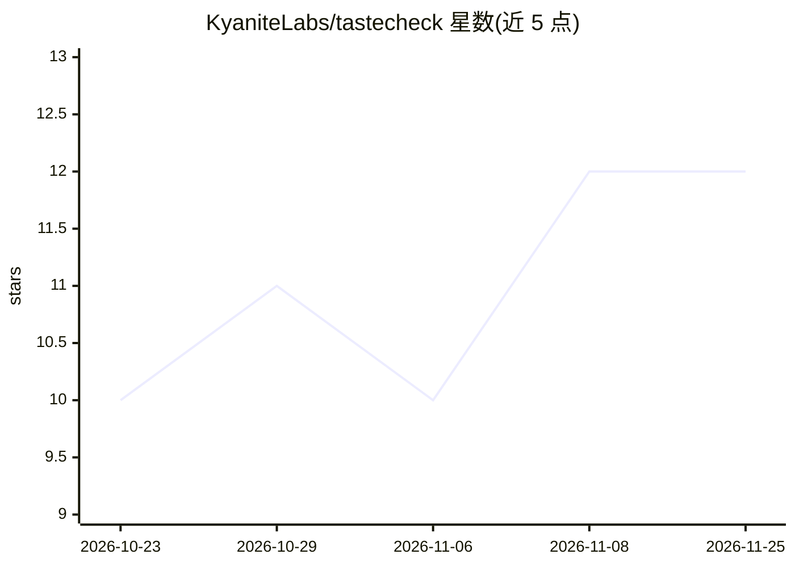

# KyaniteLabs/tastecheck

⭐ 12 · JavaScript · MIT · 推送 2026-11-23 · [GitHub](https://github.com/KyaniteLabs/tastecheck) · [官网](https://kyanitelabs.github.io/tastecheck/) · 组织维护

**给 AI 编码 agent 的前端设计技能包与发布门禁工具集**

TasteCheck 以 Markdown 形式的 20 个技能（skills）供编码 agent 读取使用：设计访谈（/designsystem）生成 DESIGN-SYSTEM.md，deslop 流程移除 AI 生成 UI 的特征样式，/tastecheckpass 作为发布门禁加载真实渲染页面并输出 SHIP 或 HOLD 及逐项证据。门禁含浏览器证据驱动脚本（Node 22+ 与本地 Chrome，仅用于该驱动），带 17 例标注语料与 CI 校验。README 声明尚未验证其能产生更好的界面。通过 git clone 加 install.sh 安装，MIT 许可。

## 筛选速览

| 维度 | 判定 | 备注 |
|---|---|---|
| AI 角色 | `ai-ecosystem` | LLM/agent 周边工具 |
| 许可风险 | `permissive` | MIT |
| 部署形态 | `None` |  |
| 模型依赖 | — | README 未给出锁定关系 |
| 硬件要求 | — | 无带数字的原话,不猜 |
| 安装摩擦 | `low` | 无编译、无系统依赖或容器化 |
| 成熟度 | `idea` | |

## 能力要点

- 20 个 Markdown 技能：设计访谈、deslop、无障碍（WCAG 2.2 AA）、主题、响应式等
- 发布门禁 /tastecheckpass 输出 SHIP/HOLD 并要求每项检查附证据
- 17 例标注语料（12 TP/1 FN/4 TN/0 FP），CI 阻止误报变差的改动
- 安装器将技能链接到 ~/.agents/skills/ 及检测到的 agent 技能目录

## 适用场景

- 让编码 agent 生成的前端界面去除 AI 默认风格
- 发布前对页面做键盘、对比度、缩放、泄漏等检查
- 在 agent 写代码前确定显式的设计方向与 token 体系

## 场景标签

`编码 Agent` · 领域:编码与开发

## 证据(README 行号)

> L5: **Your AI-built UI stops looking AI-built.** TasteCheck is a set of skills for coding agents. A short design intervi
> L14: 1. Install: `git clone https://github.com/KyaniteLabs/tastecheck && ./tastecheck/install.sh`
> L18: Skills are plain Markdown, so any agent that can read files can use them. Slash commands are for Claude Code.

## 星数曲线

2026-10-23 10 → 2026-11-25 12（+2）

---
*卡片 v1 · prompt 1.4 · 生成 2026-11-18 · 置信度 high · 依据 README sha `ca1dfec3ebbd` · [字段定义](../../DATASET.md)*
