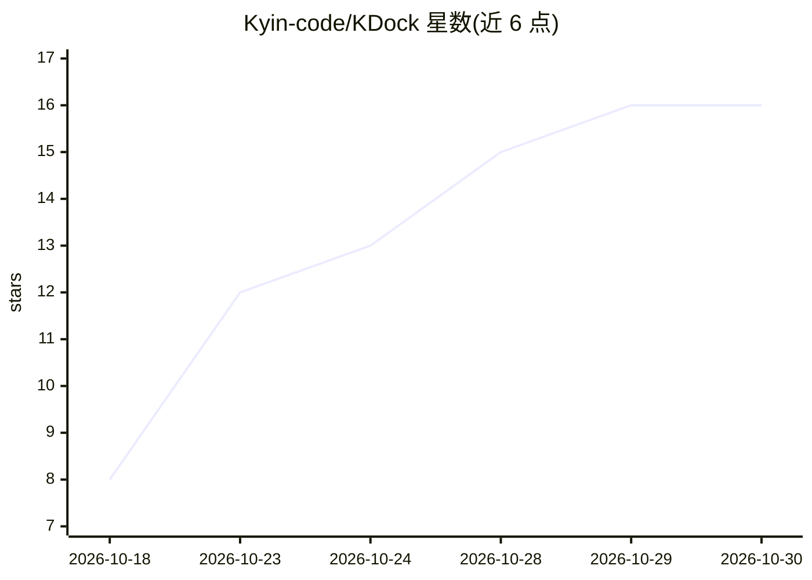

# Kyin-code/KDock

⭐ 16 · Rust · Apache-2.0 · 推送 2026-10-29 · [GitHub](https://github.com/Kyin-code/KDock) · 个人维护 · 中文 README

**面向嵌入式开发者的桌面调试工作台，内置可调用全部工具的 AI Agent**

基于 Tauri 2 + Rust 的 Windows 桌面应用，将串口/TCP/UDP/SSH 连接、OpenOCD/J-Link 烧录、设备文件传输、ADB、示波器、逻辑分析仪、ELF/BIN 固件结构分析等调试工具集中在一个窗口，每个工具同时作为 Agent 工具暴露；Agent 支持对话、技能、MCP、权限审批与自动化工作流（AGENTS.md）。固件分析器在独立 Python 子进程中运行（基于 angr/pybingraph）。目前提供跟随 main 的 Pre-release 测试版，需 Windows x64 与 WebView2 Runtime，程序未签名。

## 筛选速览

| 维度 | 判定 | 备注 |
|---|---|---|
| AI 角色 | `ai-enhanced` | 去掉 AI 部分产品仍成立 |
| 许可风险 | `permissive` | Apache-2.0 |
| 部署形态 | `desktop` | 安装包/桌面程序 |
| 模型依赖 | — | README 未给出锁定关系 |
| 硬件要求 | — | 无带数字的原话,不猜 |
| 安装摩擦 | `medium` | 含编译或系统依赖之一 |
| 成熟度 | `idea` | |

## 能力要点

- 串口/网络/烧录/设备/仪器工具集中于一处，且均可被 Agent 调用
- Agent 支持技能、MCP、工作区与权限审批
- 固件 ELF/BIN 运行结构、调用链与 CFG 分析（angr，独立 Python 子进程）
- 可用工作流、AGENTS.md 与技能固化操作与项目规范

## 适用场景

- 嵌入式开发中在一个桌面窗口完成串口调试、烧录与设备文件传输
- 让 Agent 按权限审批流程调用调试工具完成自动化任务
- 对固件做运行结构与调用链分析

## 场景标签

 · 领域:嵌入式开发/调试工具

## 证据(README 行号)

> L5: **嵌入式调试工作台 + 可调用全部工具的 Agent**
> L37: - **Agent**：对话、技能、MCP、工作区、权限审批与设备分析。
> L41: - **Agent**：描述目标，由 Agent 调用工具并按权限请求确认。

## 星数曲线

2026-10-18 8 → 2026-10-30 16（+8）

---
*卡片 v1 · prompt 1.4 · 生成 2026-10-30 · 置信度 mid · 依据 README sha `a15461b28b97` · [字段定义](../../DATASET.md)*
