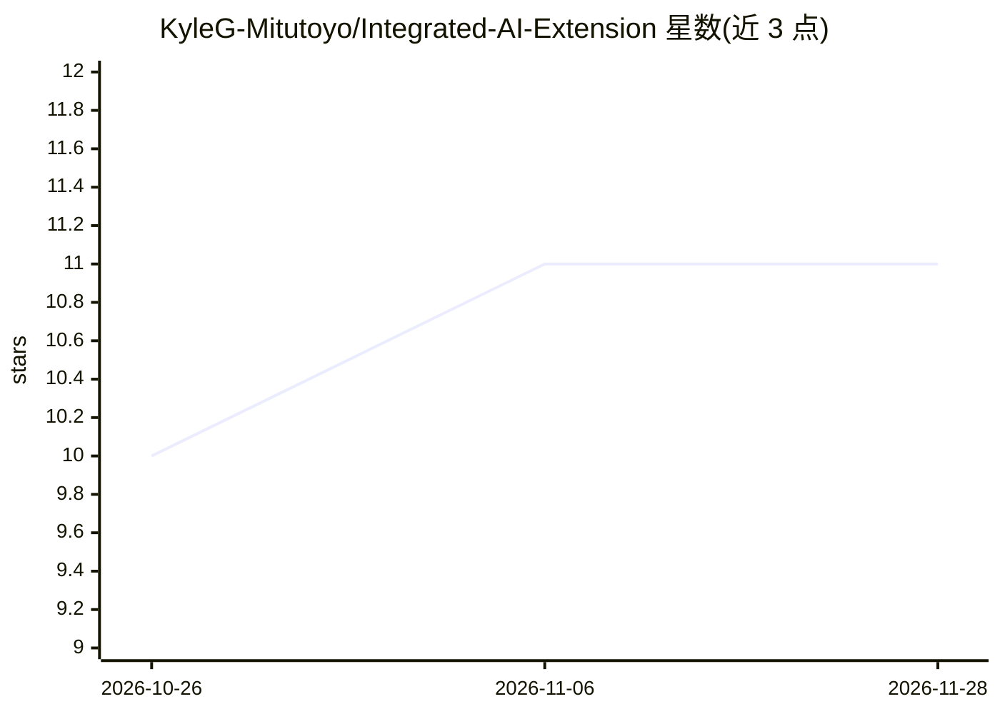

# KyleG-Mitutoyo/Integrated-AI-Extension

⭐ 11 · C# · GPL-3.0 · 推送 2026-10-12 · [GitHub](https://github.com/KyleG-Mitutoyo/Integrated-AI-Extension) · [官网](https://marketplace.visualstudio.com/items?itemName=Kyle-Grubbs.integrated-ai&ssr=false#overview) · 个人维护

**把网页 AI 聊天集成进 Visual Studio 编辑器的扩展**

面向 Visual Studio 2022/2026 的扩展，在可停靠工具窗口中打开多个网页 AI 聊天站点，用户无需 API key，使用已有的免费账号或订阅。提供右键菜单将代码片段、函数、整个文件、多个文件或错误列表条目发送到聊天提示区；AI 回复可经 diff 视图逐行审阅后接受或拒绝，接受时自动创建整个解决方案的 zip 备份，并配有还原窗口与聊天记录定位。功能命令主要针对 Visual Studio 原生语言（C#/VB/C++/F#）提供完整支持。

## 筛选速览

| 维度 | 判定 | 备注 |
|---|---|---|
| AI 角色 | `ai-ecosystem` | LLM/agent 周边工具 |
| 许可风险 | `viral` | GPL-3.0 |
| 部署形态 | `None` |  |
| 模型依赖 | locked-api |  |
| 硬件要求 | — | 无带数字的原话,不猜 |
| 安装摩擦 | `low` | 无编译、无系统依赖或容器化 |
| 成熟度 | — | 结构信号不足 |

## 能力要点

- 右键发送代码片段/函数/文件/多文件/错误信息到聊天站点
- AI 回复经 diff 视图审阅后应用，支持函数名自动匹配替换
- 接受变更时自动 zip 备份整个解决方案并提供还原窗口
- 内置 Google AI Studio、Grok、Claude、ChatGPT、Gemini、Deepseek 聊天站点列表

## 适用场景

- 在 IDE 内直接向网页 AI 聊天发送代码请求重构或加异常处理
- 将编译错误列表一键发给 AI 并定位到出错代码行
- 对 AI 建议的改动先看 diff 再决定是否应用，保留备份还原点

## 场景标签

`聊天机器人` `AI 助手` `代码审查` · 领域:编码与开发

## 证据(README 行号)

> L7: Seamlessly bridge your code editor with web AI chats, **no API keys needed!** Refactor, debug, and generate code wit
> L22: - ✅ **Stay in the Zone:** A dedicated, dockable web window with multiple AI chat sites to choose from.
> L42: - **Integrated AI Chat Window**: Open an AI chat web interface in a dockable Visual Studio tool window.

## 星数曲线

2026-10-26 10 → 2026-11-28 11（+1）

---
*卡片 v1 · prompt 1.4 · 生成 2026-11-19 · 置信度 high · 依据 README sha `57b5d4a74911` · [字段定义](../../DATASET.md)*
