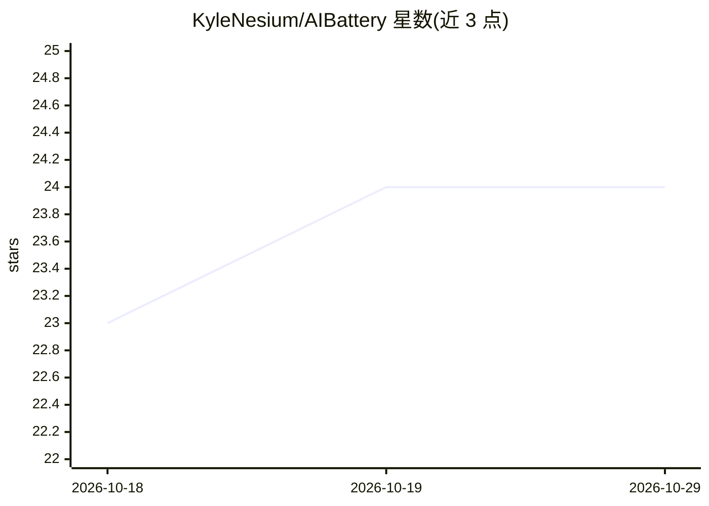

# KyleNesium/AIBattery

⭐ 24 · Swift · MIT · 推送 2026-10-24 · [GitHub](https://github.com/KyleNesium/AIBattery) · [官网](https://aibattery.dev) · 个人维护

**macOS 菜单栏应用：监控 Claude Code 与 Codex 的限额和用量**

用 SwiftUI 编写的 macOS 菜单栏应用，面向 Claude Code 与 OpenAI Codex CLI 的订阅用户：通过 OAuth 2.0 登录最多 3 个 Claude 账号和 3 个 Codex 账号，显示 5 小时/7 天滑动窗口限额、上下文占用、令牌用量图表与按项目统计，并计算 API 等价成本。本地读取两个 CLI 的 JSONL 会话日志（仅令牌计数，不读消息内容），密钥存于 macOS Keychain。需要 macOS 13+ 及 Claude Code 或 Codex CLI，提供 Homebrew、DMG 与源码构建三种安装方式。

## 筛选速览

| 维度 | 判定 | 备注 |
|---|---|---|
| AI 角色 | `ai-ecosystem` | LLM/agent 周边工具 |
| 许可风险 | `permissive` | MIT |
| 部署形态 | `desktop` | 安装包/桌面程序 |
| 模型依赖 | locked-api |  |
| 硬件要求 | — | 无带数字的原话,不猜 |
| 安装摩擦 | `low` | 无编译、无系统依赖或容器化 |
| 成熟度 | — | 结构信号不足 |

## 能力要点

- 多账号总览：每提供商最多 3 个账号，5 小时/7 天限额条与重置倒计时
- 上下文健康视图：最近 5 个会话的上下文占用百分比与 Idle 标记
- 5 小时/7 天/12 个月活动图表与按项目、按模型的 API 等价成本
- 本地读取会话日志仅取令牌计数，不读消息内容，无遥测

## 适用场景

- 在菜单栏随时查看 Claude/Codex 订阅的限额消耗与限流倒计时
- 判断何时该开新会话以避免上下文过满
- 按项目统计令牌用量并对比订阅费与 API 等价成本

## 场景标签

 · 领域:开发者工具/用量监控

## 证据(README 行号)

> L9: Rate limits, context health and token usage for Claude Code **and** OpenAI Codex, every account on one screen, alway
> L95: A minimal API fetch reads Claude Code account metadata for 5-hour and 7-day usage; Codex accounts read the ChatGPT 

## 星数曲线

2026-10-18 23 → 2026-10-29 24（+1）

---
*卡片 v1 · prompt 1.4 · 生成 2026-10-27 · 置信度 high · 依据 README sha `594f6ad702d0` · [字段定义](../../DATASET.md)*
