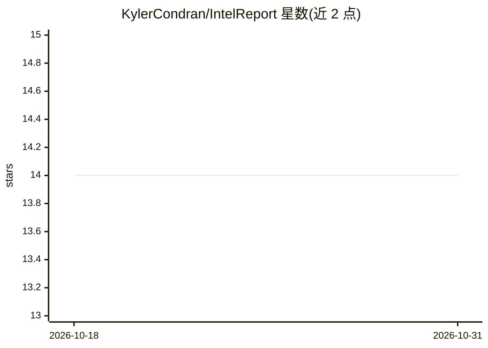

# KylerCondran/IntelReport

⭐ 14 · Python · MIT · 推送 2025-12-01 · [GitHub](https://github.com/KylerCondran/IntelReport) · 个人维护

**离线 LLM 长转录文本的情报摘要提取工具（GPT4ALL）**

面向情报分析场景的小型工具集：将长转录文本分块，用本地 GPT4ALL 模型以情报分析员视角逐块摘要，提取关键行动者、时间线、意图、指标、置信度与行动项，输出要点式情报报告；可选配合本地 Whisper AI 离线转录音频生成转录文本。通过 PowerShell 包装脚本与 Python 脚本运行，支持选择模型、线程数与推理设备（默认 CPU）。完全离线运行，不依赖云端服务。

## 筛选速览

| 维度 | 判定 | 备注 |
|---|---|---|
| AI 角色 | `ai-native` | 本体是模型或模型工具 |
| 许可风险 | `permissive` | MIT |
| 部署形态 | `None` |  |
| 模型依赖 | — | README 未给出锁定关系 |
| 硬件要求 | — | 无带数字的原话,不猜 |
| 安装摩擦 | `medium` | 含编译或系统依赖之一 |
| 成熟度 | — | 结构信号不足 |

## 能力要点

- 分块摘要机制使本地 LLM 可处理长转录文本
- 情报分析员视角提取行动者/时间线/意图/指标/置信度
- Whisper AI 本地离线转录音频（可选）
- 可选 GPU/AMD/NVIDIA/Intel 设备加速，默认 CPU

## 适用场景

- 把长篇访谈或多媒体转录稿压缩为要点式情报报告
- 离线环境（无云端）完成音频转录与分析
- 情报分析人员快速提取长文本中的行动者与时间线

## 场景标签

`语音识别` · 领域:感知与多模态

## 证据(README 行号)

> L6: - Analyze long transcripts by running `intelreport.py`, which summarizes text in chunks from the perspective of an i
> L20: - Intelligence-analyst framing: summaries and extractions tailored to analytic needs (key actors, timeline, intent,

## 星数曲线

2026-10-18 14 → 2026-10-31 14（+0）

---
*卡片 v1 · prompt 1.4 · 生成 2026-10-31 · 置信度 high · 依据 README sha `ec6ab7742d27` · [字段定义](../../DATASET.md)*
