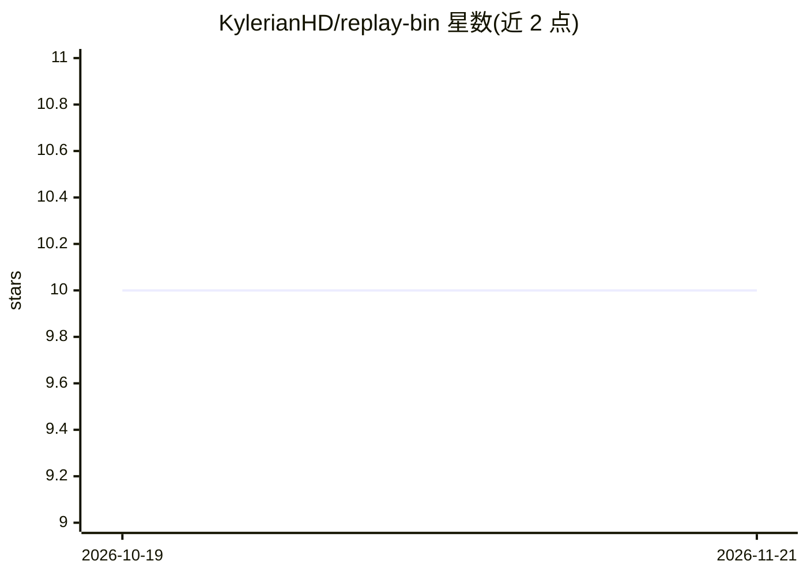

# KylerianHD/replay-bin

⭐ 10 · Shell · GPL-3.0 · 推送 2026-03-09 · [GitHub](https://github.com/KylerianHD/replay-bin) · [官网](https://aur.archlinux.org/packages/replay-bin) · 个人维护

**Replay（AI 歌曲生成/RVC 语音工具）的 AUR 打包**

本仓库是 Weights 公司 Replay 桌面应用的 AUR 打包，供 Arch Linux 用户安装。Replay 本体提供 AI 翻唱（更换人声）、文本转语音、语音转换、RVC 声音模型训练与多模型声音融合，离线本地运行但需注册 Weights 账号登录。仓库提供 yay/paru 的 AUR 安装与 makepkg 手动构建两种方式；作者声明打包许可状态不明，暂标 GPL-V3/unknown。

## 筛选速览

| 维度 | 判定 | 备注 |
|---|---|---|
| AI 角色 | `ai-native` | 本体是模型或模型工具 |
| 许可风险 | `viral` | GPL-3.0 |
| 部署形态 | `None` |  |
| 模型依赖 | — | README 未给出锁定关系 |
| 硬件要求 | — | 无带数字的原话,不猜 |
| 安装摩擦 | `low` | 无编译、无系统依赖或容器化 |
| 成熟度 | `idea` | |

## 能力要点

- AI 翻唱、TTS、语音转换、RVC 训练、多声音融合五类功能
- AUR 安装：yay/paru 或 makepkg 手动构建
- 离线本地运行，使用 Weights 平台的预训练声音模型或自训模型

## 适用场景

- 在 Arch Linux 上安装 Replay 制作 AI 翻唱
- 训练自己的 RVC 声音转换模型
- 将文本或录音转换为指定声音

## 场景标签

`语音合成` `模型训练` · 领域:内容生成

## 证据(README 行号)

> L7: Replay is a desktop application that allows you to create AI music covers, text to speech, and train your own RVC mo
> L11: - **AI Voice Covers**: Transform any song by changing the vocalist to any voice model from a voice library

## 星数曲线

2026-10-19 10 → 2026-11-21 10（+0）

---
*卡片 v1 · prompt 1.4 · 生成 2026-11-20 · 置信度 high · 依据 README sha `1857f65ba21e` · [字段定义](../../DATASET.md)*
