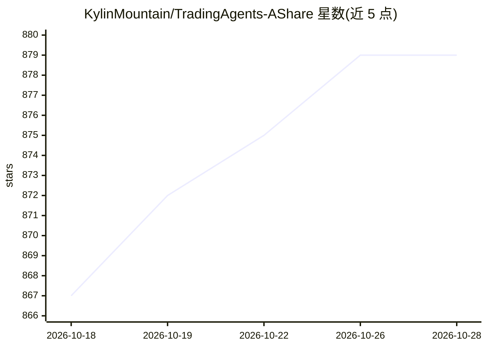

# KylinMountain/TradingAgents-AShare

⭐ 879 · Python · NOASSERTION · 推送 2026-10-21 · [GitHub](https://github.com/KylinMountain/TradingAgents-AShare) · [官网](https://app.510168.xyz) · 个人维护 · 中文 README

**A股多智能体投研系统：14个AI Agent辩论生成结构化交易建议**

基于 TauricResearch/TradingAgents 架构二次开发的 A 股分析系统：14 名智能体分分析师、多空研究员、交易员与风控团队协作，经红蓝对抗辩论后输出含方向、置信度、目标价与止损价的结构化研报。提供辩论可视化、意图驱动的自然语言交互、自选股定时分析、持仓追踪看板，支持 OpenAI/Anthropic/Gemini/DeepSeek 等多厂商模型前端切换，提供 REST API 与 OpenClaw 技能集成，Docker 一键部署。声明仅供学习研究、不构成投资建议；数据源可能存在延迟。

## 筛选速览

| 维度 | 判定 | 备注 |
|---|---|---|
| AI 角色 | `ai-native` | 本体是模型或模型工具 |
| 许可风险 | `none` | NOASSERTION |
| 部署形态 | `self-host` | docker 或自建部署 |
| 模型依赖 | — | README 未给出锁定关系 |
| 硬件要求 | — | 无带数字的原话,不猜 |
| 安装摩擦 | `low` | 无编译、无系统依赖或容器化 |
| 成熟度 | — | 结构信号不足 |

## 能力要点

- 14 名智能体多空辩论与三方风控博弈产出结构化研报
- 辩论过程可视化（Token 级流式、按 Round 分组）
- 自选股定时分析、持仓追踪与研报历史检索
- 标准 REST API 与 OpenClaw 技能（tradingagents-analysis）集成

## 适用场景

- 输入自然语言让多智能体团队生成A股个股研报与交易建议
- 自选股批量定时分析并跟踪持仓盈亏看板
- 通过 API 将分析能力接入自定义脚本或交易机器人

## 场景标签

`多智能体` `金融量化` · 领域:Agent 开发

## 证据(README 行号)

> L3: 本项目是基于多智能体协作的 A 股深度分析系统，模拟顶级投研机构的决策闭环，通过 14 名专业 Agent 的多空辩论与风控博弈，为投资者提供结构化的交易建议。
> L53: TradingAgents 模拟真实交易机构的部门协作，将复杂任务拆解为专业的智能体角色：
> L57: ### 分析师团队

## 星数曲线

2026-10-18 867 → 2026-10-28 879（+12）

---
*卡片 v1 · prompt 1.4 · 生成 2026-10-21 · 置信度 mid · 依据 README sha `965eebea1b62` · [字段定义](../../DATASET.md)*
