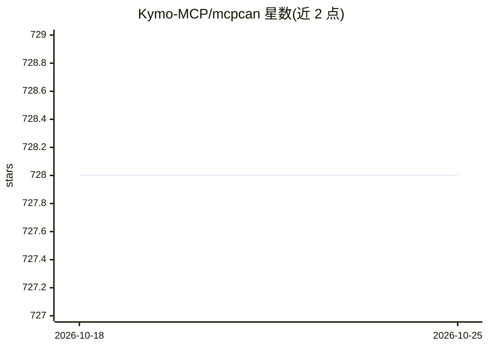

# Kymo-MCP/mcpcan

⭐ 728 · Go · NOASSERTION · 推送 2026-04-03 · [GitHub](https://github.com/Kymo-MCP/mcpcan) · [官网](https://www.mcpcan.com) · 组织维护 · 中文 README

**面向 DevOps 团队的 MCP 服务容器化集中管理平台**

MCPCan 是开源的 MCP（Model Context Protocol）服务集成与管理平台：以容器方式部署各 MCP 服务，避免系统配置冲突，支持 SSE/STDIO 等多协议兼容与转换，并提供可视化监控、身份认证与权限管理（RBAC）、市场与实例管理。采用微服务架构（Vue 3 前端 + Go/Gin 后端，MySQL/Redis 存储），支持 Docker Compose 与 Helm/Kubernetes 两种部署方式。核心功能开源采用 Sustainable Use License，`.ee` 目录的企业功能受 Enterprise License 约束。

## 筛选速览

| 维度 | 判定 | 备注 |
|---|---|---|
| AI 角色 | `ai-ecosystem` | LLM/agent 周边工具 |
| 许可风险 | `none` | NOASSERTION |
| 部署形态 | `self-host` | docker 或自建部署 |
| 模型依赖 | — | README 未给出锁定关系 |
| 硬件要求 | — | 无带数字的原话,不猜 |
| 安装摩擦 | `low` | 无编译、无系统依赖或容器化 |
| 成熟度 | — | 结构信号不足 |

## 能力要点

- 容器化部署 MCP 服务，解决系统配置冲突
- 多协议兼容与转换（SSE/STDIO 等 MCP 架构间集成）
- 可视化监控、RBAC 身份认证与 Token 校验
- Docker Compose 本地部署与 Helm/Kubernetes 云原生部署

## 适用场景

- 团队集中管理多个 MCP 服务实例与配置
- 通过 Web 界面监控 MCP 服务状态与性能
- 在 Kubernetes 环境中快速发布与分发 MCP 服务

## 场景标签

 · 领域:MCP 服务管理/DevOps 工具

## 证据(README 行号)

> L30: MCPCan is an open-source platform focused on efficient management of MCP (Model Context Protocol) services, providi
> L40: - **🎯 Unified Management**: Centralized management of all MCP service instances and configurations
> L45: - **📈 Scalability**: Cloud-native architecture based on Kubernetes

## 星数曲线

2026-10-18 728 → 2026-10-25 728（+0）

---
*卡片 v1 · prompt 1.4 · 生成 2026-10-21 · 置信度 high · 依据 README sha `62ce625971c1` · [字段定义](../../DATASET.md)*
