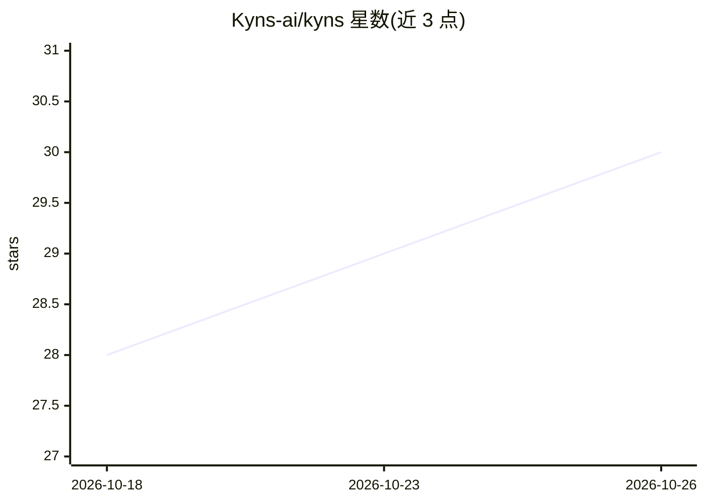

# Kyns-ai/kyns

⭐ 30 · TypeScript · MIT · 推送 2026-07-14 · [GitHub](https://github.com/Kyns-ai/kyns) · [官网](https://kyns.ai) · 组织维护

**无审查自托管 AI 聊天平台：对话、角色扮演与图像生成**

基于 LibreChat 构建的开源自托管 AI 聊天平台，面向希望绕过内容过滤直接对话的用户。提供无审查聊天、角色扮演人设、FLUX 图像生成、SearXNG+Firecrawl 网络搜索、跨会话持久记忆、Chatterbox TTS 与 Whisper STT 语音功能；对话与图像 24 小时自动删除。基于微调开源模型，通过 OpenAI 兼容端点接入 LLM（如 vLLM 反向代理）。需 Node.js 20+ 与 MongoDB 6+，以 Docker Compose 部署。

## 筛选速览

| 维度 | 判定 | 备注 |
|---|---|---|
| AI 角色 | `ai-native` | 本体是模型或模型工具 |
| 许可风险 | `permissive` | MIT |
| 部署形态 | `self-host` | docker 或自建部署 |
| 模型依赖 | local-ok | 支持本地模型 |
| 硬件要求 | — | 无带数字的原话,不猜 |
| 安装摩擦 | `low` | 无编译、无系统依赖或容器化 |
| 成熟度 | — | 结构信号不足 |

## 能力要点

- 无审查聊天与角色扮演人设，基于微调开源模型
- FLUX 图像生成与 SearXNG+Firecrawl 实时网络搜索
- 持久记忆与 24 小时自动删除的隐私机制
- Chatterbox TTS + Whisper STT 语音输入输出

## 适用场景

- 自托管一个无内容过滤的私人 AI 聊天服务
- 进行沉浸式角色扮演对话
- 在聊天中直接生成图像并检索实时网络信息

## 场景标签

`聊天机器人` `图像生成` · 领域:对话与助手

## 证据(README 行号)

> L25: KYNS is an uncensored AI chat platform built for users who want direct, honest AI conversations without the usual c
> L34: Built on top of LibreChat — see NOTICE.md for attribution.

## 星数曲线

2026-10-18 28 → 2026-10-26 30（+2）

---
*卡片 v1 · prompt 1.4 · 生成 2026-10-26 · 置信度 high · 依据 README sha `9aca3959674e` · [字段定义](../../DATASET.md)*
