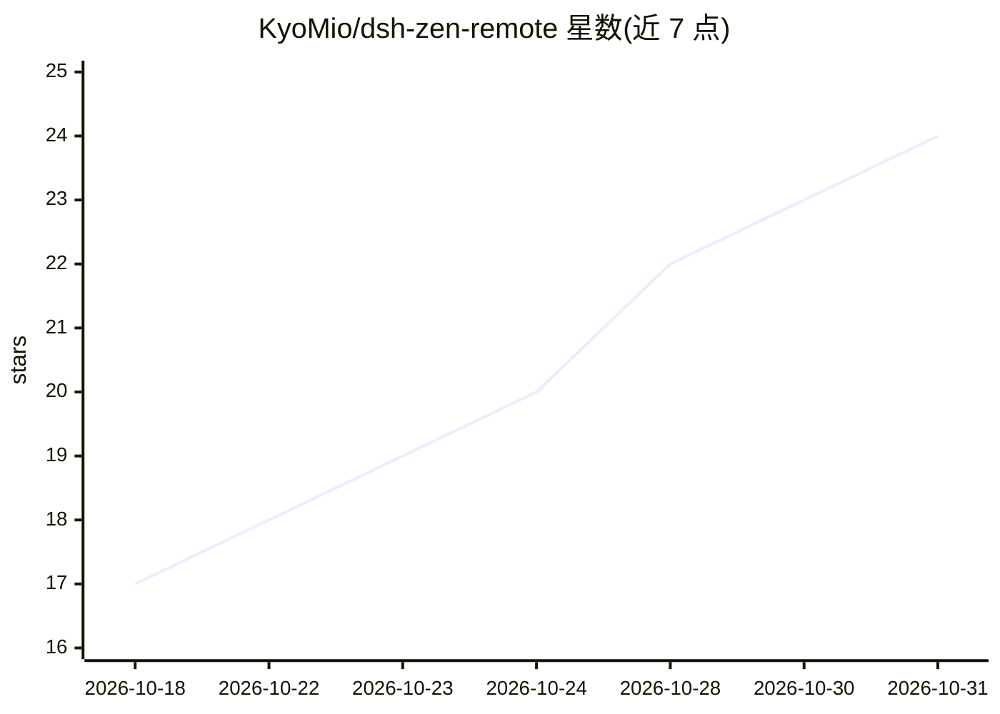

# KyoMio/dsh-zen-remote

⭐ 24 · JavaScript · NOASSERTION · 推送 2026-10-30 · [GitHub](https://github.com/KyoMio/dsh-zen-remote) · [官网](https://www.npmjs.com/package/dsh-zen-remote) · 个人维护 · 中文 README

**让手机与另一台电脑远程使用 DeepSeek Harness 的双角色插件**

DeepSeek Harness（DSH）插件，一个插件两种角色：宿主端将 DSH 变为手机可访问的 PWA，提供移动端 UI、配对码安全网关、锁屏 Web Push（aes128gcm 端到端加密），并向已配对桌面端共享指定会话；客户端角色运行于另一台 DSH 桌面应用内，将宿主共享会话挂载到自身侧栏（历史、流式回复、工具审批、终端、文件浏览与上传，均在宿主执行）。安装向导支持 Caddy/Cloudflare Tunnel/反向代理/局域网与 Tailscale 四种接入方式，共享会话 48 小时无活动自动关闭远程。

## 筛选速览

| 维度 | 判定 | 备注 |
|---|---|---|
| AI 角色 | `ai-ecosystem` | LLM/agent 周边工具 |
| 许可风险 | `none` | NOASSERTION |
| 部署形态 | `library` | 以包/库形式分发 |
| 模型依赖 | locked-api |  |
| 硬件要求 | — | 无带数字的原话,不猜 |
| 安装摩擦 | `low` | 无编译、无系统依赖或容器化 |
| 成熟度 | — | 结构信号不足 |

## 能力要点

- 宿主/客户端双角色：PWA 移动端 UI + 配对码网关 + Web Push
- 客户端将宿主共享会话挂载进自身侧栏，含审批、终端、文件上传
- 四种接入方式：托管 Caddy、现有反代、Cloudflare Tunnel、LAN/Tailscale
- 按会话粒度控制远程访问，推送载荷 aes128gcm 端到端加密

## 适用场景

- 在手机上远程查看和操作 DSH 会话，锁屏接收审批/提问通知
- 用另一台电脑挂载宿主的共享会话进行跨设备工作流
- 无公网 IP 环境经 Cloudflare Tunnel 或 Tailscale 安全暴露 DSH

## 场景标签

 · 领域:AI 桌面助手/远程访问

## 证据(README 行号)

> L2:  One DeepSeek Harness plugin, two roles. The host turns DSH into a phone-reachable PWA (mobile UI, pairing gateway, 
> L9: DeepSeek Harness 0.1.7 – 0.2.x
> L71: - **Server (`role: host`, default)**: runs your sessions, spawns the local security gateway and Web Push service, a

## 星数曲线

2026-10-18 17 → 2026-10-31 24（+7）

---
*卡片 v1 · prompt 1.4 · 生成 2026-10-28 · 置信度 high · 依据 README sha `7404efe108cf` · [字段定义](../../DATASET.md)*
