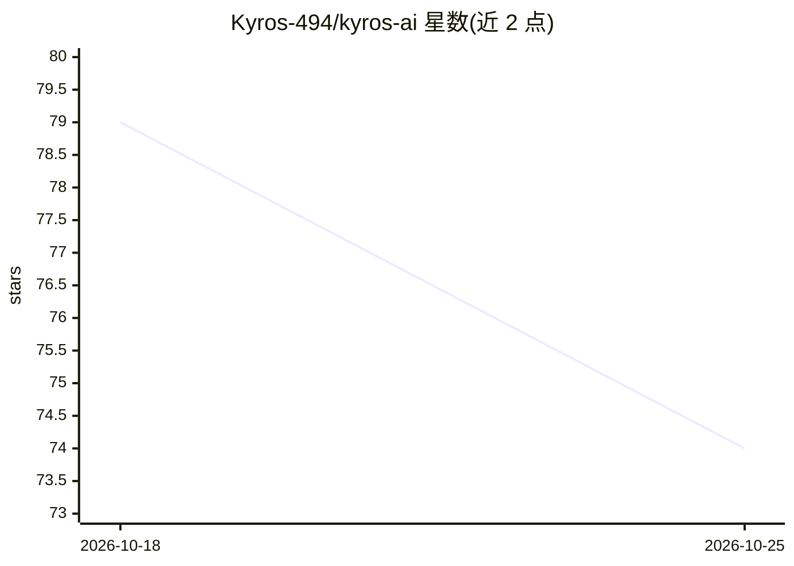

# Kyros-494/kyros-ai

⭐ 74 · Python · Apache-2.0 · 推送 2026-09-08 · [GitHub](https://github.com/Kyros-494/kyros-ai) · [官网](https://kyros-494.github.io/kyros-ai/) · 个人维护

**AI Agent 持久化记忆系统：三类记忆+遗忘曲线+防篡改**

面向 AI agent 开发者的开源记忆操作系统，通过 REST API 与 Python/TypeScript SDK 提供情景、语义、程序三类记忆，内置 Ebbinghaus 衰减曲线、SHA-256/Merkle 树完整性证明与基于信念传播的事实冲突消解。宣称模型无关，兼容 OpenAI/Anthropic/Llama 等，提供 LangChain/LlamaIndex/AutoGen/CrewAI 集成、原生 MCP 服务器接入 Cursor 等 IDE，以及多租户 API key 管理。自托管依赖 Docker 与 Docker Compose，采用 Open Core 许可模式。

## 筛选速览

| 维度 | 判定 | 备注 |
|---|---|---|
| AI 角色 | `ai-ecosystem` | LLM/agent 周边工具 |
| 许可风险 | `permissive` | Apache-2.0 |
| 部署形态 | `self-host` | docker 或自建部署 |
| 模型依赖 | — | README 未给出锁定关系 |
| 硬件要求 | — | 无带数字的原话,不猜 |
| 安装摩擦 | `low` | 无编译、无系统依赖或容器化 |
| 成熟度 | — | 结构信号不足 |

## 能力要点

- 情景/语义/程序三类记忆与类别化遗忘半衰期
- SHA-256 + Merkle 树记忆完整性证明与审计追踪
- 语义图信念传播实现事实冲突自动消解
- 原生 MCP 服务器接入 Cursor/Windsurf/Cline

## 适用场景

- 为多轮对话 agent 添加跨会话持久记忆
- 多 agent 系统中共享与隔离项目/租户级记忆
- 在 Cursor 等 IDE 中通过 MCP 调用语义记忆检索

## 场景标签

`Agent 记忆` · 领域:Agent 开发

## 证据(README 行号)

> L23: Kyros is an open-source memory operating system designed specifically for AI agents. It provides three biologically
> L39: ```python

## 星数曲线



2026-10-18 79 → 2026-10-25 74（-5）


---
*卡片 v1 · prompt 1.4 · 生成 2026-10-24 · 置信度 high · 依据 README sha `1efe80387e5a` · [字段定义](../../DATASET.md)*
