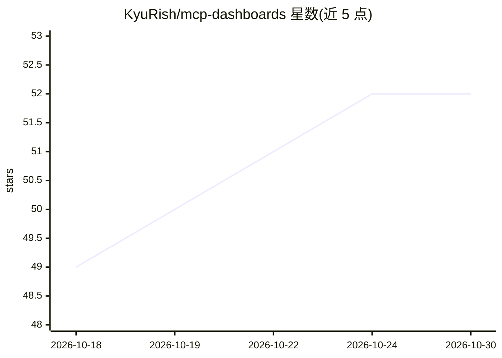

# KyuRish/mcp-dashboards

⭐ 52 · TypeScript · NOASSERTION · 推送 2026-09-10 · [GitHub](https://github.com/KyuRish/mcp-dashboards) · 个人维护

**在 AI 对话中直接渲染交互式图表与仪表盘的 MCP 服务器**

基于 MCP Apps 协议的单一 MCP 服务器，向 AI 客户端提供 32 个图表工具（覆盖 45+ 图表子类型）、21 套主题、4 个可视化目录、KPI 部件、可编辑流程图与实时轮询图表，并支持导出 PNG/PPT/A4/CSV。用户用自然语言描述需求，由 AI 调用对应工具在对话内联渲染交互式 HTML 图表。兼容 Claude Desktop、claude.ai、ChatGPT、VS Code GitHub Copilot、Goose、Postman 等客户端；无 MCP Apps 支持时回退为本地 HTTP 链接与可分享的 HTML 文件。默认绑定 localhost，自包含无 CDN 请求。仅 npm（npx）方式安装。

## 筛选速览

| 维度 | 判定 | 备注 |
|---|---|---|
| AI 角色 | `ai-ecosystem` | LLM/agent 周边工具 |
| 许可风险 | `none` | NOASSERTION |
| 部署形态 | `library` | 以包/库形式分发 |
| 模型依赖 | — | README 未给出锁定关系 |
| 硬件要求 | — | 无带数字的原话,不猜 |
| 安装摩擦 | `low` | 无编译、无系统依赖或容器化 |
| 成熟度 | — | 结构信号不足 |

## 能力要点

- 32 个图表工具覆盖 45+ 子类型（柱状/桑基/烛台/地理/流程图等）
- 对话内联渲染交互式 HTML：悬停、点击回传 AI、钻取、12x 缩放
- 实时轮询图表经 poll_http 从任意 API 自动更新，凭据留在服务端
- 导出 PNG/PPT(16:9)/A4/CSV，附浏览器回退链接与可分享 HTML 文件

## 适用场景

- 在 Claude/ChatGPT 对话里直接生成可交互的数据图表与仪表盘
- 实时监控 API 数据（如价格、组合收益）并自动更新
- 把分析结果导出为幻灯片或报告页
- 用自然语言画流程图并可拖拽编辑后同步回 AI

## 场景标签

`数据分析` · 领域:效率与自动化

## 证据(README 行号)

> L26: MCP Dashboards renders interactive charts, dashboards, and KPI widgets directly inside your AI conversation. 32 cha
> L217: Built on MCP Apps. You ask the AI to visualize data, it calls the right tool, and the chart renders inline in your

## 星数曲线

2026-10-18 49 → 2026-10-30 52（+3）

---
*卡片 v1 · prompt 1.4 · 生成 2026-10-24 · 置信度 high · 依据 README sha `2081feabd4b5` · [字段定义](../../DATASET.md)*
