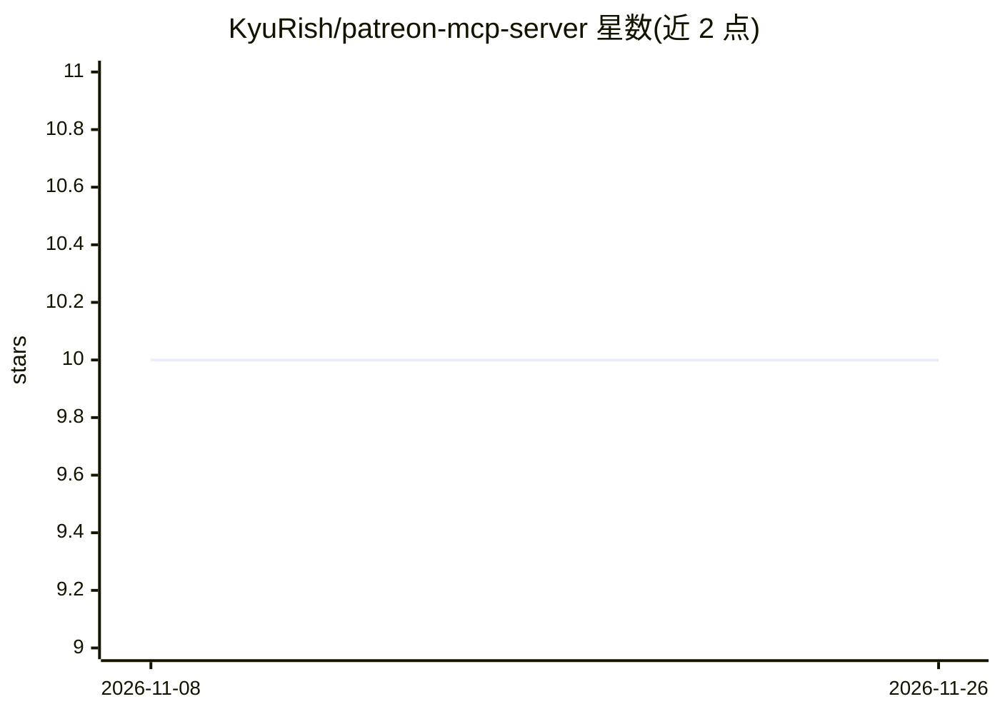

# KyuRish/patreon-mcp-server

⭐ 10 · Python · MIT · 推送 2026-03-07 · [GitHub](https://github.com/KyuRish/patreon-mcp-server) · 个人维护

**让 AI 助手读取 Patreon 创作者数据的 MCP 服务器**

基于 FastMCP 实现的 Patreon API MCP 服务器，提供 6 个只读工具：获取认证用户身份、列出与查询 campaign（含层级明细）、分页读取会员列表（100/页）与帖子列表（20/页）、按 ID 取单帖。设计上不请求会员邮箱与私人备注、不落盘缓存数据。需要 Patreon Creator Access Token，运行依赖 Python 3.11+ 与 uv 包管理器，通过 git clone 源码安装；README 提醒数据会被发送给所用 AI 服务商。与 Patreon 无官方关联。

## 筛选速览

| 维度 | 判定 | 备注 |
|---|---|---|
| AI 角色 | `ai-ecosystem` | LLM/agent 周边工具 |
| 许可风险 | `permissive` | MIT |
| 部署形态 | `library` | 以包/库形式分发 |
| 模型依赖 | — | README 未给出锁定关系 |
| 硬件要求 | — | 无带数字的原话,不猜 |
| 安装摩擦 | `low` | 无编译、无系统依赖或容器化 |
| 成熟度 | `idea` | |

## 能力要点

- 6 个只读 MCP 工具覆盖 campaign、member、post、identity 查询
- 分页通过 next_cursor 字段实现
- 隐私设计：不请求邮箱、不含私人备注、无数据存储
- 提供 Claude Desktop 与 Claude Code 的配置示例

## 适用场景

- 用自然语言查询自己的 Patreon campaign 与帖子
- 查看各等级会员数量与付款下滑的会员
- 让 Claude Desktop / Cursor 等 MCP 客户端接入 Patreon 数据

## 场景标签

 · 领域:开发者工具/MCP 集成

## 证据(README 行号)

> L10: Give AI assistants access to your Patreon creator data. The first authenticated Patreon MCP server - works with Cla
> L104:   mcp_server.py    # FastMCP init + client instance

## 星数曲线

2026-11-08 10 → 2026-11-26 10（+0）

---
*卡片 v1 · prompt 1.4 · 生成 2026-11-20 · 置信度 mid · 依据 README sha `e39eb7e86eb1` · [字段定义](../../DATASET.md)*
