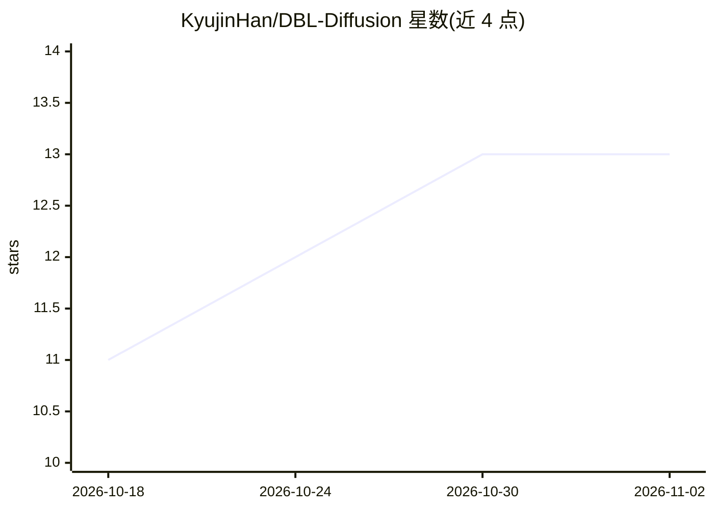

# KyujinHan/DBL-Diffusion

⭐ 13 · 推送 2026-10-03 · [GitHub](https://github.com/KyujinHan/DBL-Diffusion) · 组织维护

**视频物体插入与图层分解的双分支扩散模型（附 TriLayer 数据集）**

POSTECH 计算机图形学实验室的 arXiv 论文项目：提出 TriLayer 视频数据集（3,908 个对齐的 composite/background/foreground 三元组，前景含阴影反射等半透明效果）与 DBL-Diffusion 双分支扩散框架，联合建模 RGB 场景内容与 RGBA 前景层。实例化为两个任务：DBL-Insert 分层物体插入、DBL-Decompose 视频图层分解，另含 Appearance-Guided Background Inpainting（AGBI）背景修复方法。README 显示代码、数据集与预训练模型将在论文录用后发布，当前各节均为占位符，TO-DO 清单中推理代码、数据集、训练代码、ComfyUI 支持均未完成。

## 筛选速览

| 维度 | 判定 | 备注 |
|---|---|---|
| AI 角色 | `ai-native` | 本体是模型或模型工具 |
| 许可风险 | `none` | — |
| 部署形态 | `None` |  |
| 模型依赖 | — | README 未给出锁定关系 |
| 硬件要求 | — | 无带数字的原话,不猜 |
| 安装摩擦 | `low` | 无编译、无系统依赖或容器化 |
| 成熟度 | — | 结构信号不足 |

## 能力要点

- TriLayer 数据集：3,908 个对齐的三元组视频（composite/background/foreground）
- 双分支扩散框架通过去噪中的跨分支交互联合建模 RGB 与 RGBA 层
- 两个任务实例：DBL-Insert 分层物体插入、DBL-Decompose 图层分解
- AGBI：基于源视频外观引导修复物体移除后的背景残影

## 适用场景

- 视频分层物体插入并获得可后编辑的 RGBA 前景层
- 将视频分解为前景与背景图层
- 去除视频物体后修复背景残留伪影

## 场景标签

`图像生成` `视频生成` · 领域:内容生成

## 证据(README 行号)

> L24: Building on this dataset, we propose **🔥DBL-Diffusion🔥**, a dual-branch diffusion framework that jointly models sce
> L25: We instantiate the framework in two tasks: **⭐DBL-Insert⭐** for layered object insertion, which generates explicit 

## 星数曲线

2026-10-18 11 → 2026-11-02 13（+2）

---
*卡片 v1 · prompt 1.4 · 生成 2026-10-31 · 置信度 high · 依据 README sha `64e04d33c7d5` · [字段定义](../../DATASET.md)*
