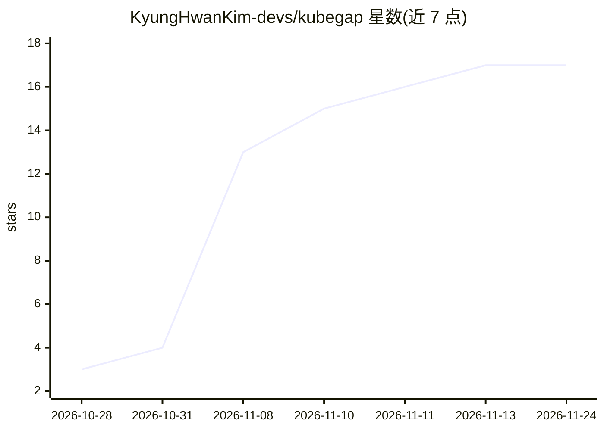

# KyungHwanKim-devs/kubegap

⭐ 17 · Python · MIT · 推送 2026-11-15 · [GitHub](https://github.com/KyungHwanKim-devs/kubegap) · [官网](https://benchlet.com/kubegap/) · 个人维护

**给 AI agent 的 Kubernetes 只读巡检技能，输出问题报告**

以 Agent Skills 格式（SKILL.md + Python 脚本）交付的集群审计技能，在 Claude Code、Codex 等能读该格式并执行 shell 的 agent 中以单命令运行。四步流程：脚本用 kubectl 只读采集集群对象/事件及 Prometheus、Alertmanager、Grafana、Loki 数据存为快照；按 412 条规则确定性评估；agent 分析汇总；生成带证据核验的 Markdown 报告（英文或韩文）。每日审计 3-5 分钟，完整审计约 15 分钟。不向集群下发命令、不读 Secret 值、不自行修复问题。

## 筛选速览

| 维度 | 判定 | 备注 |
|---|---|---|
| AI 角色 | `ai-ecosystem` | LLM/agent 周边工具 |
| 许可风险 | `permissive` | MIT |
| 部署形态 | `library` | 以包/库形式分发 |
| 模型依赖 | — | README 未给出锁定关系 |
| 硬件要求 | — | 无带数字的原话,不猜 |
| 安装摩擦 | `low` | 无编译、无系统依赖或容器化 |
| 成熟度 | — | 结构信号不足 |

## 能力要点

- 412 条检查覆盖 12 个领域，同一快照评估结果可复现
- 报告中的数字须与快照一致、链接须已验证，否则报告不予组装
- 每日/完整两种模式：每日 3-5 分钟摘要，完整审计深入节点内部与 EKS 云账户
- 全程只读，不读 Secret 值，不在集群内安装任何组件

## 适用场景

- 每天早晨跑一次快速巡检，看集群当前有什么坏了
- 接手集群、升级前或事故后做一次深度审计
- 在 Claude Code 或 Codex 里用一条命令得到可读的问题诊断报告

## 场景标签

 · 领域:云原生运维/DevOps

## 证据(README 行号)

> L7: kubegap is a skill for AI agents that audits a Kubernetes cluster read-only and writes a report of the problems that
> L24: kubegap is a skill in the Agent Skills format: a folder with a procedure for the agent to follow (`SKILL.md`) and t

## 星数曲线

2026-10-28 3 → 2026-11-24 17（+14）

---
*卡片 v1 · prompt 1.4 · 生成 2026-11-18 · 置信度 high · 依据 README sha `637d037b04ef` · [字段定义](../../DATASET.md)*
